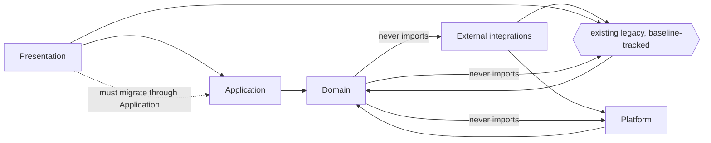
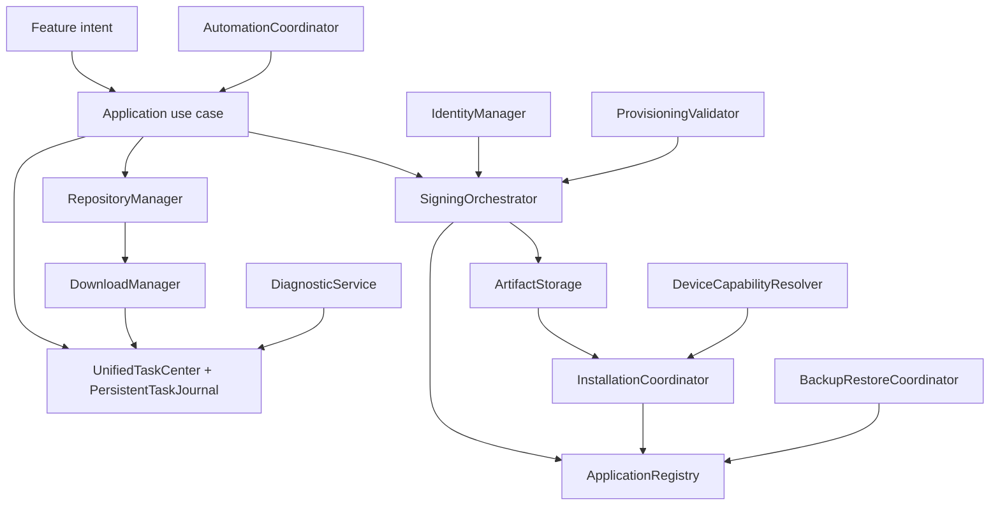
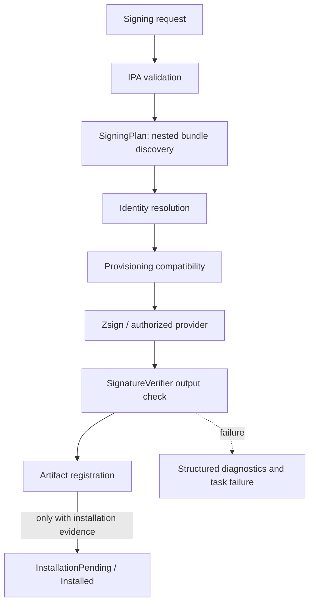

# VexSign dependency rules and diagrams

This document defines the six logical layers requested by the architecture-excellence brief. It is a **logical** map: VexSign keeps its existing folders, targets and file-system-synchronized Xcode groups. No Swift package is created merely to make the tree look modular.

The machine-readable owner map and dependency inventory are in [`component-map.json`](component-map.json). The initial audit, implementation evidence and assessment are in [`../research/architecture-excellence-audit.md`](../Research/architecture-excellence-audit.md). Source-specific decisions are recorded in [`../research/source-guided-architecture-decisions.md`](../Research/source-guided-architecture-decisions.md).

## Six layers

| Layer | Existing locations | Allowed responsibility | Must not do |
| --- | --- | --- | --- |
| Presentation | `App/iOS/VexSign/Views/`, `App/iOS/VexSign/Presentation/`, `App/iOS/VexSign/DesignSystem/`, companion SwiftUI targets | Render state, collect intent, forward to Application use cases or view models. | Directly execute signing, archive extraction, installation, provisioning, raw networking, Core Data or persistence. |
| Application | `App/iOS/VexSign/Application/` | Coordinate use cases through explicit contracts; own policies and workflow sequencing. | Import UIKit/SwiftUI/CoreData or platform-specific integration modules; call uncontrolled global state. |
| Domain | `App/iOS/VexSign/Domain/` | Framework-free value types, errors and boundary protocols. | Import SwiftUI, UIKit, CoreData, Zsign, Keychain, networking, persistence implementations or local integration packages. |
| Infrastructure | `App/iOS/VexSign/Infrastructure/`, `App/iOS/VexSign/Backend/`, `App/iOS/VexSign/Utilities/`, `Services/API/server/`, `Services/CloudSigning/cloud-signing/` | Implement contracts with Core Data, filesystem, networking, archive, signing and service adapters. | Own presentation state or bypass the single task/signing/app-lifecycle owners. |
| Platform | `App/iOS/VexSign/Platform/`, `App/iOS/VexSign/Security/`, Apple framework adapters, Xcode targets | Wrap UIKit, Keychain, device communication, installation, background execution and entitlement boundaries. | Expose platform globals back into Domain or Application. |
| External integrations | `Packages/NativeSigning/`, `Packages/SideSign/`, `Integrations/EmbeddedContainer/`, `Packages/NimbleKit/`, `Packages/AltSourceKit/`, `Packages/Vendor/`, Python/TypeScript services | Provide separately licensed engines, source compatibility, optional cloud/device services and companion runtimes. | Become a second source of truth for app lifecycle, task progress or signing orchestration. |

## Dependency direction

Dependencies point **inward** toward Domain contracts. Application depends on Domain protocols; Infrastructure and Platform implement those protocols; Presentation depends on Application/Domain abstractions; External integrations are reached through adapters.



The dashed migration arrow is important: the repository still contains historical SwiftUI views that call `Storage.shared`, `@FetchRequest`, `DirectInstaller` or `URLSession.shared`. Those files are not silently declared clean. [`../../Tools/Architecture/architecture-drift-baseline.json`](../../Tools/Architecture/architecture-drift-baseline.json) records them, and [`../../Tools/Architecture/test_architecture_excellence.py`](../../Tools/Architecture/test_architecture_excellence.py) fails if a **new** file joins a violation class.

## Core-system ownership



These names map to existing implementations; they are not new duplicate services. See the `coreSystems` array in [`component-map.json`](component-map.json) for each owner and source evidence.

## Signing pipeline boundary



A successful Zsign operation is **not** an installation claim. `InstallConfirmation` and the capability-driven installation path remain separate evidence gates.

## Enforcement rules

1. `App/iOS/VexSign/Domain/*.swift` imports Foundation only and references no `.shared`, `Storage.`, `FileManager.default` or `UserDefaults.` symbols.
2. `App/iOS/VexSign/Application/*.swift` does not import SwiftUI, UIKit, CoreData, Nuke, IDeviceSwift, AltSourceKit or SwiftSoup, and does not call `URLSession.shared`. The existing `NativeSigning` import in `AnisetteProviderUseCase` is a documented, baseline-tracked external-integration seam.
3. `AppContainer.live()` is the explicit composition root. New dependencies are injected; no new static service locator is introduced.
4. New Presentation files must not join the legacy view-coupling baseline. Removing baseline entries is an intentional migration that requires updating the ratchet and adding tests.
5. Signing, installation, download, storage and task state each have one architectural owner. A new type must extend or implement an existing contract rather than start a parallel engine.
6. Capability answers are not success evidence. Bootstrap and device acceptance remain honest prerequisites, not universal computer-free promises.
7. Secrets and sensitive account/device identifiers never enter ordinary logs or diagnostic exports; redaction is applied before display, copy, export and stdout mirroring.
8. A `Build-verified` claim requires a green macOS CI build/test run for the exact reviewed commit. A `Device-verified` claim requires real iPhone evidence.

## Running the drift audit

```sh
python3 Tools/Architecture/test_architecture_excellence.py --report
python3 Tools/Architecture/test_architecture_excellence.py          # unittest gate
python3 Tools/Architecture/test_architecture_excellence.py --write-baseline  # after an intentional migration
```

`make verify` and the CI `Docs and regressions` step run the ordinary unittest form. The `--write-baseline` form is deliberately manual: a baseline change must be reviewed, not produced automatically by CI.

See the accepted decision record in [`../changes/architecture-excellence-drift-guard.md`](../Engineering/Changes/architecture-excellence-drift-guard.md).
