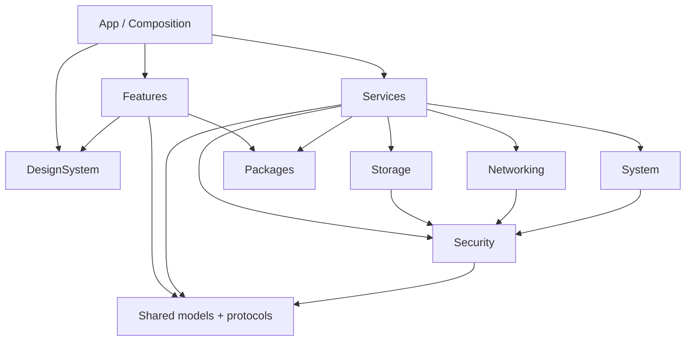

# Dependency rules

The architecture is a set of allowed edges, not a count of folders. `AppContainer` is the
only place where concrete implementations are chosen; every other layer depends on the
stable contracts in `VexSign/Shared/Protocols/`.

## Direction

Arrows point from the dependent to the dependency. There are no arrows back into a
feature from a lower layer, and no feature imports another feature's implementation.

## Allowed edges

| From | May depend on | Must not depend on |
| --- | --- | --- |
| `App` | `Features`, `Services`, `DesignSystem`, `Shared`, `Platform` adapters | concrete infrastructure in a view body |
| `Features` | `Shared/Models`, `Shared/Protocols`, `DesignSystem`, its own feature ports | signing engines, `Storage`, `Networking`, `System` implementations, other features' internals |
| `Shared` | Foundation and other `Shared` subfolders | `SwiftUI`, `UIKit`, Core Data, any app layer |
| `Services` | `Shared`, `Security`, `Storage`, `Networking`, `System`, `Packages` | SwiftUI views, feature presentation state |
| `Security` | `Shared`, Foundation, security packages | SwiftUI, UIKit, Core Data, feature or storage implementations |
| `Storage` | `Shared`, `Security/Credentials` for key derivation | redefining a trust or signing policy |
| `Networking` | `Shared`, `Security/Policies` | feature types, persistence types, UI frameworks |
| `System` | `Shared`, OS frameworks behind protocols | security decisions, feature implementations |
| `Packages` | their own manifests and other declared packages | the app target |

## Rules that matter most

1. **Features coordinate; they do not implement engines.** A signing screen calls a port
   injected by `AppContainer`; it never calls `ZsignEngine`, `NativeSigningManager` or a
   bare `URLSession`.
2. **Security decides.** Certificate validity, signing policy, trust evaluation and
   entitlement validation live in `VexSign/Security/`. `Storage/Keychain` holds secrets
   but never re-decides whether they are acceptable.
3. **Storage persists.** It does not decide security policy, and it does not leak Core Data
   managed objects into views.
4. **Networking moves bytes.** API, redirect and download policy comes from
   `Security/Policies` through protocols such as `SecureTransferProviding`.
5. **System adapts the OS.** Device transport, pickers, background tasks and App Intents
   stay behind interfaces and never become a feature dumping ground.
6. **Packages are justified modules.** Only `NativeSigning`, `DeviceBridge`, `SideSign`,
   `AltSourceKit`, `NimbleKit` and `Vendor` exist. Do not create a package per feature.
7. **Platform code stays platform-specific.** TV, Vision and Watch sources live in
   `Platform/`; iOS code is not copied into them to "share" a screen.
8. **Tests protect the edges.** Boundary drift is a build failure, not a review comment.

## Enforcement

- `test_architecture_boundaries.py` — layer imports and composition-root wiring.
- `test_feature_workspace_boundaries.py` — cross-feature workspace edges.
- `test_architecture_excellence.py` — ratcheted presentation/domain drift rules.
- `test_repository_layout.py` — root tree, synchronized roots, aliases and empty folders.
- `test_style_config.py`, `test_environment_injection_policy.py`,
  `test_color_policy.py`, `test_haptics_policy.py` — concrete UI-side boundaries.

Adding a new edge requires a test in the same commit. Documentation without an
assertion is not an enforced boundary.

See also [`security-boundaries.md`](security-boundaries.md) and the
[`root map`](root-map.md).
