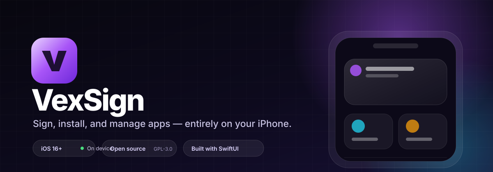
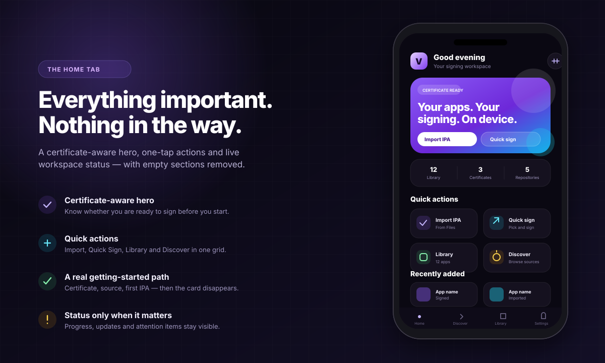
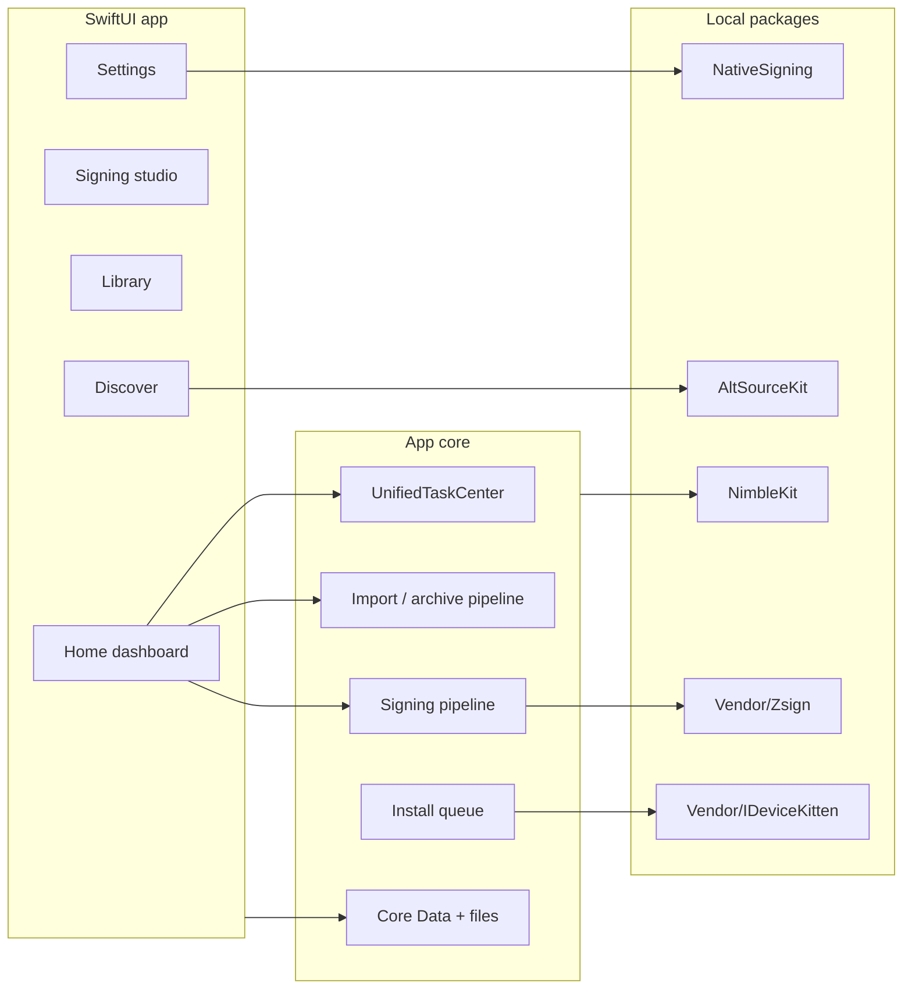

<div align="center">
  

  <p>
    <a href="https://github.com/raynmahbub/VexSign/releases"></a>
    <a href="https://github.com/raynmahbub/VexSign/actions/workflows/ci.yml"></a>
    <a href="LICENSE"></a>
    
    
  </p>

  <p><strong>A native signing studio for iPhone, iPad, Apple TV, Watch and Vision Pro.</strong></p>

  <p>
    <a href="https://github.com/raynmahbub/VexSign/releases/latest"><b>Download</b></a>
    &nbsp;·&nbsp;
    <a href="docs/README.md"><b>Documentation</b></a>
    &nbsp;·&nbsp;
    <a href="docs/BUILD.md"><b>Build from source</b></a>
    &nbsp;·&nbsp;
    <a href="CONTRIBUTING.md"><b>Contribute</b></a>
  </p>
</div>

---

VexSign is an on-device IPA signing and app-management workspace. Import a
certificate and a provisioning profile, sign an app, inspect its archive, and
install it — without a Mac in the loop and without uploading your signing
identity anywhere.

> [!IMPORTANT]
> VexSign needs a valid signing identity, and installation support depends on
> your device, certificate and provisioning profile. Native Apple ID
> provisioning and the guest-host container are experimental, not
> production-ready. Use sideloading tools in accordance with your agreements
> and applicable law.

## Why VexSign

| | |
| --- | --- |
| **Private by default** | Signing happens on device. Certificates, profiles and passwords stay in the app's protected storage; there is no VexSign signing cloud. |
| **One coherent workflow** | Import, inspect, sign, install and update share the same task model, progress UI and error guidance. |
| **At home on iOS** | Built with SwiftUI and the system design language across iOS, iPadOS, tvOS, watchOS and visionOS, with Dynamic Type, VoiceOver and Reduce Motion support. |
| **Open and inspectable** | Every source file, build check and third-party package is in this repository. The signing engine and device bridge are vendored, not hidden behind submodules. |

## The workspace

<table>
<tr>
<td width="50%" valign="top">

### Sign

- Import `.p12` identities and `.mobileprovision` profiles.
- Inspect certificate expiry, revocation and profile compatibility before signing.
- Edit bundle identifiers, versions, display names and entitlements.
- Sign with the bundled Zsign engine, then verify the result.
- Install over local HTTPS, with idevice or through the companion flow.

</td>
<td width="50%" valign="top">

### Manage

- Keep signed and imported apps in one Library.
- Pin favourites, batch-sign, clone, thin and export.
- Track certificates, profiles and app updates in one place.
- Clean storage with previews and safety rules.
- Lock the app and hide sensitive entries behind biometrics.

</td>
</tr>
<tr>
<td valign="top">

### Discover

- Add AltStore-compatible repositories.
- Browse, search and install community apps.
- Follow updates and choose per-app update rules.
- Build and validate your own repository source.

</td>
<td valign="top">

### Extend

- Inspect IPA archives and Mach-O binaries.
- Inject tweaks and review the resulting bundle.
- Automate with Shortcuts, App Intents, widgets and Live Activities.
- Use the authenticated Web Manager for browser and WebDAV transfers.

</td>
</tr>
</table>

## A calmer Home

<p align="center">
  
  <sub>Layout preview of the rebuilt Home dashboard.</sub>
</p>

The Home tab is built around the next useful action, not a wall of settings:

- a certificate-aware hero that tells you whether you are ready to sign;
- one-tap **Import**, **Quick Sign**, **Library** and **Discover** actions;
- a three-step setup checklist for a new install;
- live task progress, update and attention cards;
- recently added apps and the workspace tools you actually use.

The interface follows your selected appearance — System, Midnight Violet,
Graphite, Paper, OLED, Luna or Flare — while every surface keeps readable
contrast and native accessibility behaviour. See
[Design](docs/DESIGN.md) for the tokens and rules.

## How it fits together



More detail: [Architecture](docs/ARCHITECTURE.md).

## Install

Download the latest unsigned IPA from
[Releases](https://github.com/raynmahbub/VexSign/releases) and sign it with
VexSign, or add the AltStore-compatible source:

```text
https://raw.githubusercontent.com/raynmahbub/VexSign/main/app-repo.json
```

First time here? Read [Free Apple ID setup](docs/FREE_APPLE_ID_SETUP.md),
[companion signing](docs/COMPANION_SIGNING.md) and
[platform support](docs/PLATFORMS.md).

## Build from source

**Requirements:** macOS with a current Xcode, or the matching CI runner. No Git
submodules, recursive clone or extra package checkout is required.

```bash
git clone https://github.com/raynmahbub/VexSign.git
cd VexSign
make bootstrap          # validates the toolchain and resolves packages
open VexSign.xcworkspace
```

Select your development team in Xcode, then build the `VexSign` scheme.

The command-line build is unsigned:

```bash
make                    # packages/VexSign.ipa
make verify             # repository, resource and policy gates
make test               # simulator tests
make lint               # optional SwiftLint pass
```

| Target | What it does |
| --- | --- |
| `make bootstrap` | Checks macOS/Xcode, vendored packages and resolves SwiftPM dependencies. |
| `make` | Builds the unsigned IPA into `packages/`. |
| `make verify` | Runs the fast, Xcode-independent checks used by CI. |
| `make test` | Runs simulator tests on an available iPhone. |
| `make lint` | Runs SwiftLint when installed. |
| `make strict-concurrency` | Reports Swift 6 concurrency warnings in the local packages. |
| `make deploy-server` | Builds the optional self-hosted repository server. |

The full sequence, troubleshooting and CI notes are in
[Build](docs/BUILD.md).

## Repository map

```text
VexSign/                 iOS/iPadOS app, design system and feature views
VexSignTests/            Simulator tests
NativeSigning/           Experimental native account/provisioning package
AltSourceKit/            Repository source parsing (local Swift package)
NimbleKit/               Shared SwiftUI and utility layer (local Swift package)
Vendor/                  Pinned third-party sources (Zsign, IDeviceKit)
VexSignTV/               tvOS companion
VexSignVision/           visionOS companion
VexSignWatch*/           watchOS companion and widgets
server/                  Self-hosted Python repository server
cloud-signing/           TypeScript cloud-signing service
EmbeddedContainer/       Experimental guest-host packaging
docs/                    Guides, architecture and design notes
tools/                   Repository verification and maintenance tools
```

## Quality gates

Every change is checked without needing a Mac:

- Python policy checks for the Xcode project, localisation catalogue, error
  handling, singletons and concurrency escapes;
- workflow trigger policy and embedded-container packaging tests;
- the native-signing preparation suite;
- on macOS, an unsigned device build plus simulator tests.

See [CI](.github/workflows/ci.yml) and run `make verify` before opening a pull
request. Warnings that precede the baseline are tracked in
[`.github/build-warnings-baseline.json`](.github/build-warnings-baseline.json).

## Security and privacy

- Local signing never leaves the device. Optional companion and cloud flows are explicit, documented and opt-in.
- Imported archives are validated before extraction and signing.
- Network endpoints use TLS; the local install server generates a fresh
  identity per device.
- Repository sources are parsed defensively and are never executed.
- Secrets are redacted from logs and exports.

Please report vulnerabilities privately via GitHub's **Report a vulnerability**
button in the Security tab. See [SECURITY.md](SECURITY.md).

## Documentation

| Guide | |
| --- | --- |
| [Documentation index](docs/README.md) | Every guide in one place |
| [Build](docs/BUILD.md) | Toolchain, build order, CI and troubleshooting |
| [Architecture](docs/ARCHITECTURE.md) | Layers, data flow and local packages |
| [Design](docs/DESIGN.md) | Colour, type, surfaces, motion and accessibility |
| [Platforms](docs/PLATFORMS.md) | iOS, iPadOS, tvOS, watchOS and visionOS support |
| [Free Apple ID](docs/FREE_APPLE_ID_SETUP.md) | On-device provisioning walkthrough |
| [Companion signing](docs/COMPANION_SIGNING.md) | Apple TV, Watch and Vision flows |
| [Native signing](docs/NATIVE_SIGNING_ARCHITECTURE.md) | Experimental account backend |
| [Web tools](docs/WEBTOOLS.md) | Web Manager, API and WebDAV |
| [Releasing](docs/RELEASING.md) | Tags, builds and release assets |
| [Changelog](CHANGELOG.md) | What changed, release by release |

## Status

VexSign is an actively developed sideloading workspace. The app and the local
packages build on iOS 16 and later; the default branch tracks the newest SDK.
Some surfaces are intentionally marked experimental — see
[Platforms](docs/PLATFORMS.md) before relying on them.

## Contributing

Read [CONTRIBUTING.md](CONTRIBUTING.md), follow the
[Code of Conduct](CODE_OF_CONDUCT.md), keep changes focused, add regression
coverage, and run `make verify` plus the affected tests. Design changes should
use the tokens and accessibility rules in [Design](docs/DESIGN.md).

## Credits

VexSign builds on [Feather](https://github.com/claration/Feather) and the work of
the sideloading community. Third-party code includes
[Zsign](https://github.com/zhlynn/zsign),
[idevice](https://github.com/jkcoxson/idevice),
[ElleKit](https://github.com/everythingappletech/ElleKit), Vapor, Nuke,
ZIPFoundation and others. Vendored packages and their licences are listed in
[`Vendor/README.md`](Vendor/README.md).

VexSign is not affiliated with Apple. Apple, iPhone, iPad, Apple TV, Apple Watch
and visionOS are trademarks of Apple Inc.
