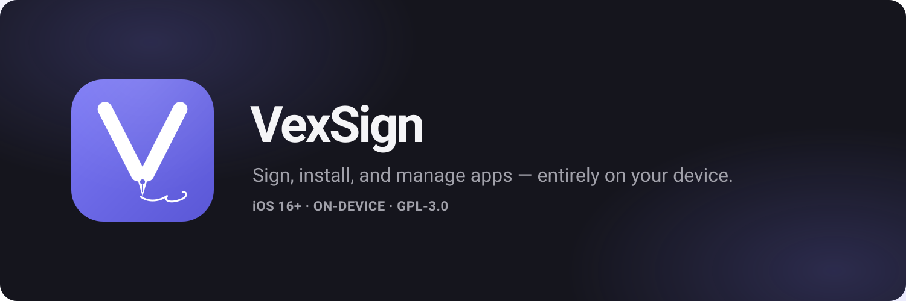

<div align="center">
  
  <h1>VexSign</h1>
  <p><b>Import → inspect → sign → install. One on-device IPA workspace.</b></p>
  <p>
    <a href="https://github.com/raynmahbub/VexSign/releases/latest"></a>
    <a href="https://github.com/raynmahbub/VexSign/blob/main/LICENSE"></a>
    <a href="https://github.com/raynmahbub/VexSign/actions/workflows/ci.yml"></a>
  </p>
  <p><a href="#download">Download</a> · <a href="#build--test">Build</a></p>
  
</div>

VexSign combines local IPA signing, app management, repository discovery and
inspection tools in a native SwiftUI app for iPhone and iPad.

> **Know the limits:** installation requires a valid signing identity and a
> compatible device/profile. Native Apple ID provisioning and guest-host
> packaging are experimental. TV, Watch and Vision apps are **companions**, not
> standalone signers. No tool can bypass Apple's certificate or provisioning rules.

## Why choose VexSign?

Choose it when you want **local control and an integrated workflow**, rather than
switching between a signer, archive inspector, repository browser and file manager.
Local signing uses the bundled Zsign engine; optional companion/cloud paths are
separate, opt-in flows. Open source means you can inspect the implementation and
self-host the optional services—not that every feature is production-ready.

## Features

Every capability listed here has an implementation in this repository. Presence in
the source is not device acceptance — the caveats in each section still apply.

### ✍️ Signing & installation
<details>
<summary><strong>✍️ Signing & installation</strong></summary>


- **On-device IPA signing** powered by Zsign.
- **Batch signing and install queues** for processing multiple apps with per-app settings.
- **Reusable signing profiles** and named presets for repeat workflows.
- **Signing options and entitlement management**, with preflight checks and signing logs.
- **Local HTTPS installation** using `itms-services://`, plus paired installation through the AFC / `installd` backend.
- **Signing Live Activities** to follow progress on supported devices.
- **Auto-sign workflows** and **Update All** for re-signing source updates.
- **Identity-aware unattended signing:** if Apple Account is the selected signing identity, a local download/import or Shortcut keeps the package and opens the attended provisioning review with that app preselected. Browser uploads return a review-required response. None of these paths substitutes a stored `.p12`.

</details>

### 🧩 Customization & IPA tools
<details>
<summary><strong>🧩 Customization & IPA tools</strong></summary>


- **Tweak injection** for `.dylib`, `.deb`, `.framework`, `.bundle` and `.appex` inputs, with ElleKit support. A `.deb` payload may be uncompressed or compressed as `.xz`, `.lzma`, `.gz`, `.bz2` or `.zst`; the same list is what the refusal message names, and `ArchiveFormat` is its single source.
- **Tweak management** to organize injection components, with dependency-aware ElleKit injection and legacy Substrate replacement.
- **Mach-O thinning** to remove non-target architectures from supported universal binaries.
- **Document picker fixes**, keychain isolation and optional JIT entitlement settings. Entitlements alone do not guarantee JIT availability on a device.
- **IPA Explorer** for browsing app contents and editing `Info.plist`, files and images.
- **Clone Wizard** to create 1–20 numbered clones from a library app, rewriting identifiers and display names.
- **Clone icon badges** when a writable PNG icon is available; cloned apps still need compatible signing options and profiles.
- **File manager**, document browsing, QuickLook previews and file/compression settings.

</details>

### 📚 Sources, discovery & updates
<details>
<summary><strong>📚 Sources, discovery & updates</strong></summary>


- **GitHub IPA import** — browse up to 20 public releases from a repository and choose an IPA; prereleases are opt-in and existing download/auto-sign settings apply.
- **AltStore-compatible repositories** through AltSourceKit, including the existing encrypted ESign parsing support.
- **GitHub release sources** — add a public GitHub repository with exactly one `.ipa` asset in its latest release. GitHub releases do not publish bundle IDs, so automatic update matching may be unavailable for these entries.
- **Source management and preferences**, repository refresh and app update tracking.
- **HTTPS-only repository transport**, with an explicit opt-in for local HTTP repositories.
- **Source health dashboard** — last successful refresh, failure reasons, retry counts, rate-limit status, priority and duplicate-app resolution.
- **Discovery** with multi-term search, suggestions, favorites, categories and collections.
- **Featured, recommended, locally ranked trending and recently updated views** with app cards and carousels.
- **Bundle-ID grouping and multi-source version selection** for apps offered by multiple repositories.
- **Offline repository catalog** — the last successful snapshot of every source is kept on disk, clearly marked as a saved copy when a refresh fails, so browsing keeps working with no network.
- **Conditional repository sync** using ETag / Last-Modified, unchanged-content detection and coalesced refreshes.
- **Last-known-good source retention** when refreshes fail, plus opt-in startup/background refresh.
- **Per-app update rules** — ignore a version, ignore or prefer a source, pin a certificate, disable automatic updates and preserve custom signing options across updates.
- **Premium activation, restore and device recovery** through the configured backend, with premium catalog filters.
- **App self-update checking**, with a one-time local notification when a newer release appears, and controls for skipped source updates. Updating VexSign itself is done in place: sign the release in Library with the certificate the installed build was signed with, and the update sheet serves it from this device so iOS replaces the bundle. No certificate, key or password is ever sent to an updater, and paired self-replacement stays gated.

</details>

### 🛠️ Repository Builder & sharing
<details>
<summary><strong>🛠️ Repository Builder & sharing</strong></summary>


Available from **Settings → Ecosystem**.

- Create, edit, save and delete repository projects.
- Import repository JSON from files or HTTPS URLs.
- Export `source.json` and `apps.json`, with format selection and conversion for supported public JSON fields.
- Validate entries, probe links and apply supported URL/screenshot fixes.
- Generate and export **OTA manifests, installation links and QR codes**.

> OTA export does not upload your files or configure hosting. Installation requires a reachable HTTPS host and a correctly signed IPA. Repository conversion supports a common public JSON subset, not every provider-specific field.

</details>

### ⬇️ Downloads & file transfer
<details>
<summary><strong>⬇️ Downloads & file transfer</strong></summary>


- **Background downloads** with progress, speed tracking, pause/resume/stop controls, Live Activities and Dynamic Island support where available. Download controls are not a promise of resumable IPA extraction.
- **Wi-Fi-only and charging-only download conditions**.
- **HTTPS/WebDAV file transfer** through the built-in web manager.
- **SHA-256 hashing** in download logs and file verification against a supplied hash.
- **Game Mode** to pause downloads and background work.

</details>

### 🔐 Certificates & security
<details>
<summary><strong>🔐 Certificates & security</strong></summary>


- Import and manage signing certificates and provisioning profiles.
- **Certificate status monitoring**, batch checks and expiry reminders.
- **Certificate Dashboard** with profile payloads, entitlements, team information, expiry countdowns and device/bundle scope.
- **Local trust / OCSP checks**, status indicators and opt-in best-effort daily checks and alerts.
- **Local HTTPS trust setup** using a device-generated TLS identity; no shared certificate pack is downloaded by the normal build.
- **Optional community certificate catalogue** (hosted by a third party, off until you read and accept its warning). It imports a shared identity whose password is published, so anyone can sign apps that claim to come from it and its owner can revoke it at any time — fine for trying the workflow, not for anything you care about.
- **P12 password recovery tools** for your own password-protected certificates.
- **Face ID / passcode app lock** when the app leaves the foreground.
- **Keychain-backed secret storage and migration** for supported passwords and API credentials.
- **Profile compatibility, nested-bundle coverage and output verification** to surface identity/extension mismatches and invalid signed outputs.
- **Signed source metadata verification** for supported publisher signatures; a verified publisher is not proof that an IPA is safe.
- **Authenticated Web Manager** with explicit network access, API-token controls and separate certificate-export permission.
- **Opt-in local activity analytics** in Diagnostics. Recording is off by default; while off, no new counts are stored, and stored counts never leave the device.
- **Anti-Revoke DNS profile tools** for verification-host filtering; these do not guarantee protection from certificate revocation.

</details>

### ⚡ Automation, cleanup & backup
<details>
<summary><strong>⚡ Automation, cleanup & backup</strong></summary>


- **Scheduled automation** with hourly-to-daily best-effort frequency, update-check/sign policy, per-app and per-source auto-update controls, Wi-Fi-only enforcement, certificate selection, optional install-queueing and completion summaries. iOS controls actual background execution times.
- **Siri & Shortcuts**: App Intents for signing a chosen app, installation, repository refresh, certificate checks, URL downloads, section navigation, Game Mode, Update All, cleanup and signing the latest download; library-summary actions expose status to automations. See **Settings → Siri & Shortcuts**.
- **Widgets**: certificate/update status **and a configurable Repository Apps widget** (pick a repository, sort by name or updates-first, tap a row to open that app), plus **Live Activities** for supported signing/download workflows.
- **Automatic post-install cleanup**, delete-after-install/cache settings, cleanup history, storage breakdown and cleanup previews. Batch-install behaviour still needs device acceptance.
- **Encrypted `.vexbackup` backup and restore**, including opening a backup from Files, AirDrop, a share sheet or “Open in”. A handed-over file is only staged: you still enter its password and choose what comes back, so nothing restores on its own.
- **Local analytics** with daily, weekly and monthly charts for recorded signing/install activity, certificate/source events and storage gauges.
- **Console and signing logs** for troubleshooting, plus diagnostic ZIP export with secret-redaction filters. Review diagnostics before sharing.

</details>

### 📺 Companion platforms
<details>
<summary><strong>📺 Companion platforms</strong></summary>


Apple TV, Apple Vision Pro and Apple Watch apps mirror what the phone is doing.
They cannot sign or install — no certificate, no IPA storage, no `installd` — so
they show certificate health, library and update state instead, and the watch can
trigger a refresh, a certificate check, Update All or a cleanup on the phone.

- **Apple TV** (tvOS 17+): focus-first status screen over the Web Manager API.
- **Apple Vision Pro** (visionOS 2+): spatial glass panels, same data.
- **Apple Watch** (watchOS 10+): certificate countdown, counts, four remote
  commands over WatchConnectivity, plus a complication widget.

See [companion platforms](#companion-targets) for pairing, build commands and the
limits.

</details>

### 🌐 Web tools
<details>
<summary><strong>🌐 Web tools</strong></summary>


Served by the backend under `/tools`, and linked from **Settings → Ecosystem →
Web Tools**:

- **Signer Console** — queue IPAs in a browser and get signed ones back; the
  page relays to the phone's Web Manager, so signing still happens on-device.
- **Repository Creator** — build, validate and export a source feed plus OTA
  manifests in the browser.
- **Repository Decoder** — read any feed (AltStore, SideStore, flat schema,
  `apps.json`, legacy appdata XML), see what it contains, export it in another
  dialect.
- **App Installer** — turn a hosted IPA into an `itms-services://` link and
  probe the URL so a spinner that never resolves is caught here instead.
- **Certificate Status Checker** — expiry, team, entitlements and device scope
  from a provisioning profile; never accepts a `.p12` or a password.
- **UDID Grabber** — one-time enrolment profile, in-memory session, no storage.

See the [Web Manager contract](Tools/Validation/security-validation/evidence/service-contracts.md) for the route table, authentication and the
privacy stance.

</details>

### 🎨 A native workspace
<details>
<summary><strong>🎨 A native workspace</strong></summary>


- SwiftUI navigation, search, material surfaces and availability-gated Liquid Glass styling.
- System, Midnight Violet, Graphite, Paper, OLED, Luna and Flare appearances, tint and app-icon settings.
- Dynamic Type, VoiceOver and Reduce Motion support; setup health and searchable settings.
- Configurable launch tab, tab visibility/order (Home and Settings remain available), and an icon-only tab bar option.
- Ecosystem tools grouped in a dedicated settings entry point.

<details>
<summary><strong>Developer components & implementation status</strong></summary>

This repository also contains optional services and experimental tooling beyond the everyday signing workflow:

- **Native account provisioning:** experimental Apple-account authentication/provisioning and anisette-provider configuration; not a complete, device-validated Apple ID signer.
- **Guest-host packaging:** a separately built LiveContainer/SideStore prototype with pinned inputs; not the normal VexSign IPA. Scope and validation status are recorded in the commit history rather than in a maintained document.

- **Python backend:** premium key validation, device binding, recovery, gated feeds, admin key management and IPA catalog endpoints. See [`Services/WebManager/API/`](Services/WebManager/API).
- **Native cloud bridge:** endpoint/token configuration and connection testing, with client methods for remote signing jobs. Requires a compatible deployed backend.
- **Cloud-signing infrastructure:** a separate TypeScript/Fastify API with JWT authorization, PostgreSQL, Redis/BullMQ queues, private S3 storage, worker contracts, webhook retries and OTA endpoints. See [`Services/Cloud/`](Services/Cloud).
- **OTA server pages:** manifest/download endpoints, installation links and QR codes, with optional app images, screenshots and changelogs.
- **Tests and CI:** iOS test sources, backend tests and cloud-service tests alongside build/deployment tooling.

**Cloud signing is not a turnkey feature:** no signing engine/sandbox launcher is bundled. The native client bridge and settings do not by themselves provide a deployed signing service. It requires infrastructure, a signer integration and end-to-end validation. Discovery rankings are local, not global popularity statistics; background schedules are controlled by iOS.

For feature boundaries, security caveats and remaining device testing, read
[`Packages/Vendor/manifest.json`](Packages/Vendor/manifest.json), which pins every
vendored dependency and its licence.

</details>

For upstream changes and pinned revisions, see
[vendored dependencies and licences](Packages/Vendor/manifest.json).

</details>

## Download

Download an IPA or add the VexSign source to a compatible signer:

[](https://github.com/raynmahbub/VexSign/releases/latest)
[](https://celloserenity.github.io/altdirect/?url=https%3A%2F%2Fraw.githubusercontent.com%2Fraynmahbub%2FVexSign%2Fmain%2Fapp-repo.json)

- **Self-hosted Safari install:** distributors with an eligible pre-signed IPA can
  generate a first-install site from the signing screen.
- **Stable:** the download button opens the latest stable release; choose its IPA asset.
- **Nightly:** browse [all releases](https://github.com/raynmahbub/VexSign/releases) for dated pre-releases.
- **Temporary CI build:** open [CI runs](https://github.com/raynmahbub/VexSign/actions/workflows/ci.yml),
  select a completed full run and download its **`VexSign-unsigned-…`** artifact.
  GitHub sign-in may be required to download artifacts. The artifact contains the
  Debug IPA, commit/version metadata and SHA-256 checksums, expires
  after **14 days**, and is not a public release. Check the build **and** test
  jobs; an available artifact alone does not mean all tests passed. Quick-only or
  failed-build runs do not produce an IPA. Older runs may have no IPA or a shorter retention period; the 14-day setting applies to new uploads.

The **Add Source** button uses a third-party link helper. If it cannot open your
signer, paste the source URL below manually.

#### Add the VexSign source directly

Already using a compatible signer? Open one of these links to add the stable VexSign feed:

- [Add to VexSign](vexsign://source/https://raw.githubusercontent.com/raynmahbub/VexSign/main/app-repo.json)
- [Add to AltStore](altstore://source?url=https%3A%2F%2Fraw.githubusercontent.com%2Fraynmahbub%2FVexSign%2Fmain%2Fapp-repo.json)
- [Add to SideStore](sidestore://source?url=https%3A%2F%2Fraw.githubusercontent.com%2Fraynmahbub%2FVexSign%2Fmain%2Fapp-repo.json)

If a link does not open your app, copy the stable source URL shown below and add it manually.

### Start signing

Download an **unsigned IPA** from [Releases](https://github.com/raynmahbub/VexSign/releases)
and sign it with an existing sideloading tool/identity. Existing VexSign users can
sign an update in-app. Stable source URL:

```text
https://raw.githubusercontent.com/raynmahbub/VexSign/main/app-repo.json
```

Read the [Web Manager contract](Tools/Validation/security-validation/evidence/service-contracts.md) before enabling those flows.

## Declared capabilities and their limits

`Info.plist` and the entitlements ask iOS for the capabilities below. Each one is a
promise to the user and, for a distributed build, to App Review.

| Declared | Where | What it actually buys, and its limit |
|---|---|---|
| Background keep-alive | `VexSign/System/BackgroundTasks/BackgroundTaskManager.swift` | An in-flight install, download, signing or Web Manager session renews a `UIApplication.beginBackgroundTask` assertion and posts an expiration notice. **No audio session is activated and no `audio` mode is declared.** iOS may still suspend the app at its own discretion; long operations are best-effort while backgrounded and reconcile on return. |
| `UIBackgroundModes: download`, `fetch`, `processing` | `Configuration/BuildSettings/iOS/Info.plist` | Standard background `URLSession` and `BGTaskScheduler` work. iOS decides when refresh/processing runs; the automation UI says so rather than promising a schedule. |
| `UIBackgroundModes: remote-notification` | same | Notification delivery, not silent remote execution. |
| `NSLocalNetworkUsageDescription`, `NSBonjourServices` (`_http._tcp`, `_webdav._tcp`) | same | The in-app Web Manager and companion discovery on the LAN. A locked or backgrounded phone may suspend the server unless the keep-alive above holds, and the user must grant the Local Network permission. |
| `NSFaceIDUsageDescription` | same | App Lock. No biometric data leaves the device. |
| `NSUserNotificationUsageDescription` | same | Not a key iOS reads — notifications ask for permission at runtime. Declared so this section accounts for everything in `Info.plist`. |
| `NSAppTransportSecurity → NSAllowsLocalNetworking` | same | Only local-network cleartext is permitted. There is **no** `NSAllowsArbitraryLoads`; remote sources must be HTTPS. |
| `com.apple.security.application-groups` → `group.com.vexsign.app` | `Configuration/Entitlements/iOS/VexSign.entitlements` | Shared container for the app, widget and extensions. |
| `get-task-allow = false` | same | Correct for distribution; a debug build overrides this. |

### What VexSign cannot do, on any device

- **No background installation.** Installation is driven by `installd` through the
  device connection while the app is running.
- **No automatic re-signing of an already-installed app.** Re-signing requires
  importing and signing a package again.
- **No JIT installation, no sandbox escape, no signature bypass.** Anything in this
  space that requires private APIs is out of scope.
- **Free Apple ID accounts expire.** A profile from a free account lasts about seven
  days and allows a small number of app IDs; VexSign surfaces expiry rather than
  working around it.
- **Cloud signing is not a bundled feature.** `Services/Cloud/` needs its own
  deployment and a signing engine the operator supplies.
- **App Review applies to external testers.** Internal TestFlight testers do not
  require review; external testers do.

### Parity caveats that are now explicit

- **Import actions follow the saved signing state.** The Get/import button now says
  Add to Library, Sign or Sign & Install according to auto-sign and the saved
  install option, matching the Feather-family workflow. An Apple Account identity
  still opens the attended review instead of substituting a stored certificate.
- **Combined repository news** merges every source, removes duplicate identifiers and
  shows the newest bounded set. It is no longer limited to the first source.
- **Paired AFC / `installd` installation** is present in code but stays behind the
  inventory-bridge and exact-installed-version gates. A pairing file or an active
  VPN does not unlock it, and it is tracked as `needsDevice` in Feature Status.
- **Local activity analytics are opt-in and off by default.** No new counts are
  stored while off, and stored counts never leave the device. Turning the toggle off
  gives the same no-analytics behaviour as a build without the counters.
- **Computer-free bootstrap** is an acceptance path, not a claim. The local report
  binds a human observation to one exact IPA SHA-256; nothing is advertised as
  device-verified until that report passes.

### Distribution risks a beta must accept explicitly

1. **Background execution is best-effort.** The app no longer declares `audio` to
   extend non-audio work. `BackgroundTaskManager` renews a normal background task
   assertion and posts an expiration notice, but iOS may still suspend an operation;
   the caller reconciles when the app returns.
2. **Repository fetch policy is shared, not identical.** `SourceFeedLoader` now caps
   size and checks the feed structure on the add-source path, matching the policy
   `RepositorySyncEngine` applies. The sync engine still adds ETag caching and a
   last-known-good snapshot; that extra behaviour remains specific to background sync.
3. **Web Manager TLS is locally issued.** Browsers and companion devices must trust
   the device CA separately; the in-app flow says so.

### Evidence status

The CI design, runner setup and report meanings are documented in
[`Documentation/CI/automated-qa.md`](Documentation/CI/automated-qa.md).

| Evidence | Status |
|---|---|
| Linux gates (`quick_check`, `Tools/`) | Pass locally and in CI's `quick` job; these read source and never compile Swift |
| iOS build and simulator tests | **Unverified here.** No Swift/Xcode toolchain was available locally. The last merged validation run (PR #282) had a failed `build` job and a failed simulator-test job, so it is not evidence of a green native build. |
| XCUITest interactions (`UITests/`) | **Unverified here.** A separate `VexSignUITests` target, scheme and `ui-tests` CI job exist, but no simulator run has been observed. Screenshots are attached to each test and uploaded with the `xcresult`; an install is never claimed from a simulator tap. |
| Physical-device acceptance | **Pending.** [`Tools/Audit/device-acceptance.py`](Tools/Audit/device-acceptance.py) covers 12 baseline checks plus optional native-handoff, bootstrap and renewal cases; its 28 Python tests validate report structure only. [`Tools/Audit/feature-acceptance.py`](Tools/Audit/feature-acceptance.py) adds one bound case for each of the 41 registered features. No device result has been observed. |

## Build & test

Use macOS and an Xcode with the SDK required by the current branch (the app uses
iOS 26 SDK APIs; the minimum deployment target is iOS 17.0, and newer APIs are behind
availability checks). `make bootstrap` validates your environment and resolves packages.

By default the paid macOS jobs in CI run only on a public repository. A trusted private
repository can accept the billed minutes by setting the repository variable
`VEXSIGN_PRIVATE_MACOS_VALIDATION=true`; otherwise those jobs are skipped and the
`quick` job says so in its summary. A skip is not build evidence.

```bash
git clone https://github.com/raynmahbub/VexSign.git
cd VexSign
make bootstrap
open VexSign.xcworkspace   # VexSign scheme; choose your development team
make                      # unsigned packages/VexSign-<version>.ipa
make verify               # portable checks; no Xcode required
make test                 # iPhone simulator tests (macOS/Xcode)
make test-ui              # simulator XCUITest interactions and screenshots
make help                 # all supported entry points
```

The `Makefile` is the supported entry point; `make help` lists every target.

> **Build note.** Two rules decide whether the project compiles. No folder-synchronized
> root may sit inside another one — a nested root is claimed by more than one target,
> which yields `Unable to find module dependency` and `Multiple commands produce
> .../PrivacyInfo.xcprivacy`. And every first-party source root must be named by some
> target's synchronized groups: a root no target lists is never compiled, so the types
> it holds go missing. The iOS target therefore synchronizes the ten roots under
> `VexSign/` (`App`, `Features`, `Shared`, `Storage`, `Networking`, `System`, `Security`,
> `DesignSystem`, `Services`, `Resources`), while each companion synchronizes its own
> folder in `Platform/` plus the specific files it shares with the app.
> `check_project_wiring.py` enforces both rules before Xcode runs.

### Source layout

There is one application source root, `VexSign/`, and one directory per layer inside it:
`App`, `Features`, `DesignSystem`, `Shared`, `Services`, `Storage`, `Networking`,
`Security`, `System` and `Resources`. Repository-level directories sit beside it:
`Platform` (TV, Vision, Watch and the widget extension), `Packages`, `Services` (the
separately deployed `Cloud`, `WebManager` and `Integrations` backends), `Tests`, `Tools`,
`Configuration` and `Documentation`. Anything the app must contain at runtime lives in
`VexSign/Resources`, because the targets use Xcode folder-synchronization and only bundle
what is inside their own folder. `App/` holds lifecycle, bootstrap, composition and
navigation; `Features/` holds the user-facing screens; `Services/` orchestrates
workflows; `Security/` owns signing, cryptography, certificate and policy decisions;
`System/` owns the operating-system integrations. The companion targets live in
`Platform/`. `SharedPlatformInfo/` stays in `VexSign/Resources/` because the iOS app
bundles it. Existing target names, bundle identifiers, schemes and the experimental host
integration are retained. `Documentation/Architecture/README.md` is the baseline for
which layer owns what, and `test_repository_layout.py` enforces the layout, including the
exact tool-owned wrapper exceptions. Multi-child folders are not flattened.

Domain/Application are Foundation-only; migrated workflows use injected ports.
Legacy UI-to-storage/service coupling is still tracked, not claimed to be fully
removed.
The source reorganization does not establish an Xcode build or device capability.

## Quality & releases

- **CI:** relevant PRs/main changes get portable policy checks, an unsigned build
  and separate simulator unit/UI test jobs. Component workflows validate their
  own paths separately.
- **Self-hosted Safari install:** distributors with an eligible pre-signed IPA can
  generate a first-install site from the signing screen.
- **Stable:** reviewed version bump, matching `v<MARKETING_VERSION>` tag or manual
  Release run, validation/build/tests, protected publishing and a stable-source update PR.
- **Nightly:** daily **03:00 UTC**, immutable dated pre-release, build/tests and
  checksums; never promoted into the stable source listing.
- **Autopilot:** grouped dependency PRs, every-4-hours validation/merging of narrow green
  bot updates, weekly localisation maintenance and failure triage. Reviewed version
  bumps can trigger stable releases automatically; risky changes stay manual.
## Trust, contribution & VexSign ownership

Local signing keeps signing work on-device; optional remote flows have different
trust boundaries. Archives are validated before extraction, and the local install
server uses a device-specific TLS identity. Do not put credentials in issues.

[GPL-3.0 license](LICENSE)
