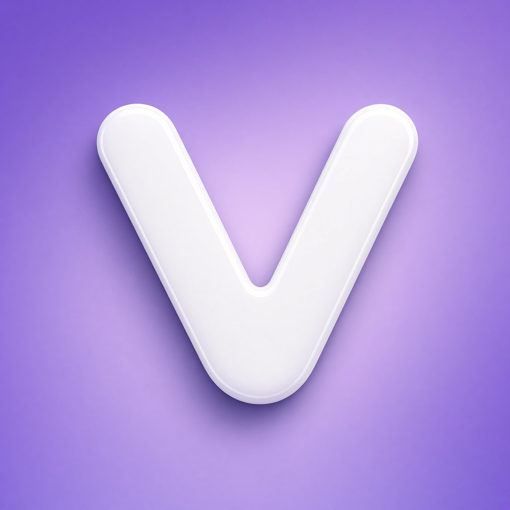

<div align="center">
  
  <h1>VexSign</h1>
  <p><b>Import → inspect → sign → install. One on-device IPA workspace.</b></p>
  <p><a href="https://github.com/raynmahbub/VexSign/releases/latest">Download</a> · <a href="docs/README.md">Guides</a> · <a href="docs/BUILD.md">Build</a> · <a href="CONTRIBUTING.md">Contribute</a></p>
</div>

VexSign combines local IPA signing, app management, repository discovery and
inspection tools in a native SwiftUI app for iPhone and iPad.

> **Know the limits:** installation requires a valid signing identity and a
> compatible device/profile. Native Apple ID provisioning and guest-host
> packaging are experimental. TV, Watch and Vision apps are **companions**, not
> standalone signers. No tool can bypass Apple's certificate or provisioning rules.

## Why choose VexSign?

Choose it when you want **local control and an integrated workflow**, rather than
switching between a signer, archive inspector, repository browser and file manager.
Local signing uses the bundled Zsign engine; optional companion/cloud paths are
separate, opt-in flows. Open source means you can inspect the implementation and
self-host the optional services—not that every feature is production-ready.

| Workspace | Features |
| --- | --- |
| **Sign & install** | Import `.p12` certificates and `.mobileprovision` profiles; inspect expiry, revocation and compatibility; edit bundle ID, version, name and entitlements; sign and verify; local HTTPS, idevice and companion installation flows. |
| **Manage apps** | Imported/signed Library, favourites, batch signing, cloning, thinning, export, update tracking, storage cleanup previews and biometric protection. |
| **Discover** | AltStore-compatible sources, app browsing/search, update rules, repository creation/validation and signed source metadata. |
| **Inspect & extend** | IPA and Mach-O inspection, tweak injection and bundle review. |
| **Automate & transfer** | Shortcuts, App Intents, widgets, Live Activities, authenticated browser Web Manager, API and WebDAV. |
| **Make it yours** | System, Midnight Violet, Graphite, Paper, OLED, Luna and Flare appearances; Dynamic Type, VoiceOver and Reduce Motion support. |
| **Connect devices** | TV/visionOS status and library views; Watch status, remote commands and complications. See [platform limits](docs/PLATFORMS.md). |
| **Self-host & experiment** | Optional Python repository/web-tools server, TypeScript cloud signer, native account/provisioning package and guest-host container. See the [component guides](docs/README.md#component-guides). |

These are project capabilities, not a claim that every device or third-party IPA
is supported. Prefer a simpler tool if you only need one-off signing; prefer a
mature provisioning workflow if experimental Apple ID support is a deal-breaker.

## Get started

Download an **unsigned IPA** from [Releases](https://github.com/raynmahbub/VexSign/releases)
and sign it with an existing sideloading tool/identity. Existing VexSign users can
sign an update in-app. Stable source URL:

```text
https://raw.githubusercontent.com/raynmahbub/VexSign/main/app-repo.json
```

Read [Free Apple ID setup](docs/FREE_APPLE_ID_SETUP.md),
[installation/companion limits](docs/COMPANION_SIGNING.md) and
[Web Manager setup](docs/WEBTOOLS.md) before enabling those flows.

## Build & test

Use macOS and an Xcode with the SDK required by the current branch (the app uses
iOS 26 SDK APIs). `make bootstrap` validates your environment and resolves packages.

```bash
git clone https://github.com/raynmahbub/VexSign.git
cd VexSign
make bootstrap
open VexSign.xcworkspace   # VexSign scheme; choose your development team
make                      # unsigned packages/VexSign.ipa
make verify               # portable checks; no Xcode required
make test                 # iPhone simulator tests (macOS/Xcode)
make help                 # all supported entry points
```

See [Build](docs/BUILD.md) for toolchain selection and troubleshooting.

## Repository layout

| Location | Responsibility |
| --- | --- |
| `VexSign/`, `VexSignTests/` | Main app and simulator tests |
| `AltSourceKit/`, `NimbleKit/`, `NativeSigning/`, `SideSign/` | Local Swift packages and signing integration |
| `VexSignTV/`, `VexSignVision/`, `VexSignWatch*/`, `VexSignWidgetExtension/` | Companions and extensions |
| `Vendor/`, `Tweaks/`, `EmbeddedContainer/` | Third-party sources, injection and experimental host packaging |
| `server/`, `cloud-signing/`, `AnisetteServer/` | Optional services; each has its own setup/limitations |
| `Scripts/`, `tools/`, `.github/` | Bootstrap, validation, maintenance and workflows |
| `docs/` | Task-oriented guides; start at the [index](docs/README.md) |

Keep source paths stable: Xcode target membership, package manifests and packaging
scripts depend on them. Generated IPAs, credentials and build caches do not belong in Git.

## Quality & releases

- **CI:** relevant PRs/main changes get portable policy checks, an unsigned build
  and simulator tests. Component workflows validate their own paths separately.
- **Stable:** reviewed version bump, matching `v<MARKETING_VERSION>` tag or manual
  Release run, validation/build/tests, protected publishing and a stable-source update PR.
- **Nightly:** daily **03:00 UTC**, immutable dated pre-release, build/tests and
  checksums; never promoted into the stable source listing.
- **Autopilot:** grouped dependency PRs, hourly validation/merging of narrow green
  bot updates, weekly localisation maintenance and failure triage. Reviewed version
  bumps can trigger stable releases automatically; risky changes stay manual.
  See [one-time setup and limits](docs/AUTOPILOT.md).

[Release/version rules](docs/RELEASING.md) · [Automation policy](docs/MAINTENANCE.md)

## Trust, contribution & credits

Local signing keeps signing work on-device; optional remote flows have different
trust boundaries. Archives are validated before extraction, and the local install
server uses a device-specific TLS identity. Report vulnerabilities privately as
explained in [SECURITY.md](SECURITY.md); do not put credentials in issues.

[Contributing](CONTRIBUTING.md) · [Code of conduct](CODE_OF_CONDUCT.md) ·
[Changelog](CHANGELOG.md) · [GPL-3.0 license](LICENSE)

Built on Zsign, idevice, ElleKit and other open-source projects; retain their
[third-party licenses](Vendor/README.md) and [ElleKit license](LICENSE_ELLEKIT).
Independent project, not affiliated with Apple.
