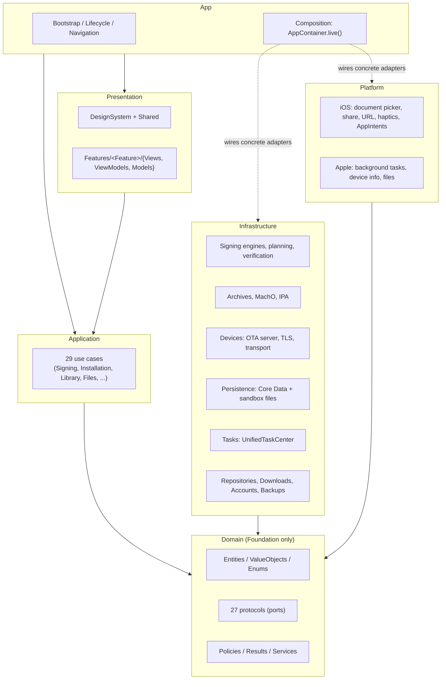
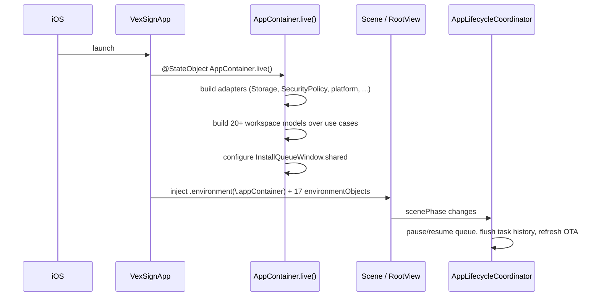
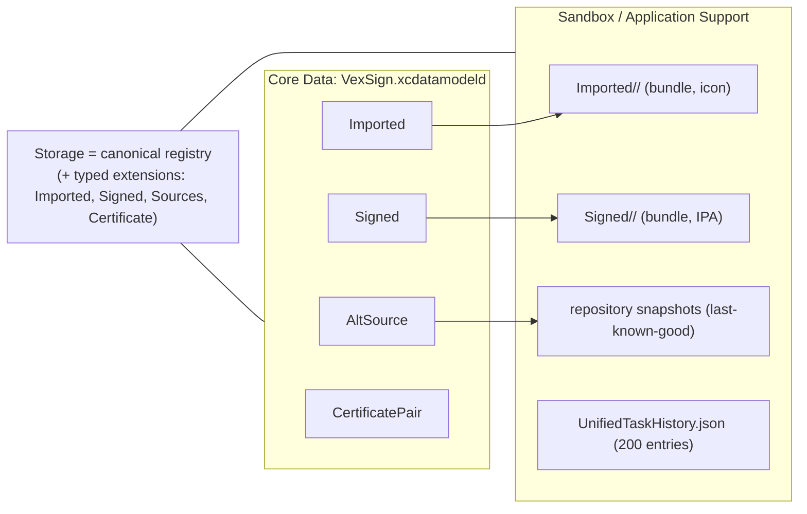
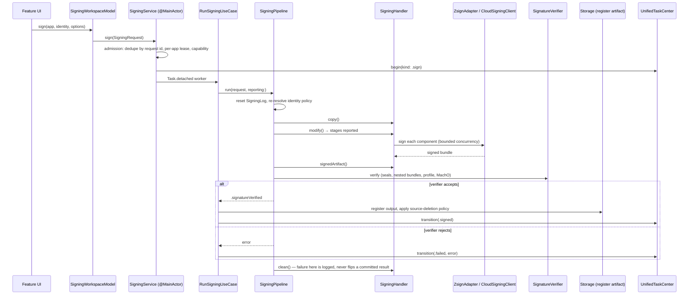
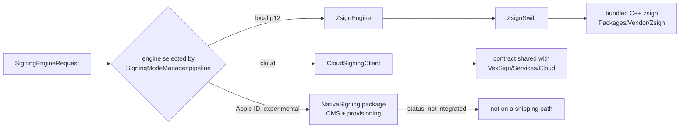
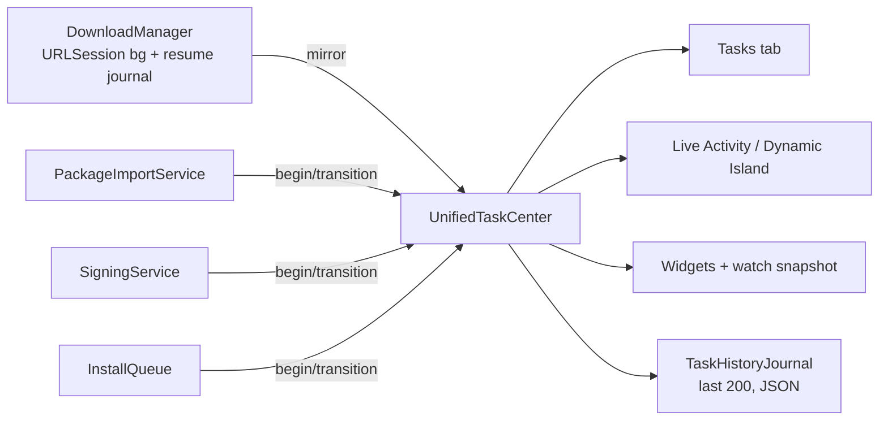
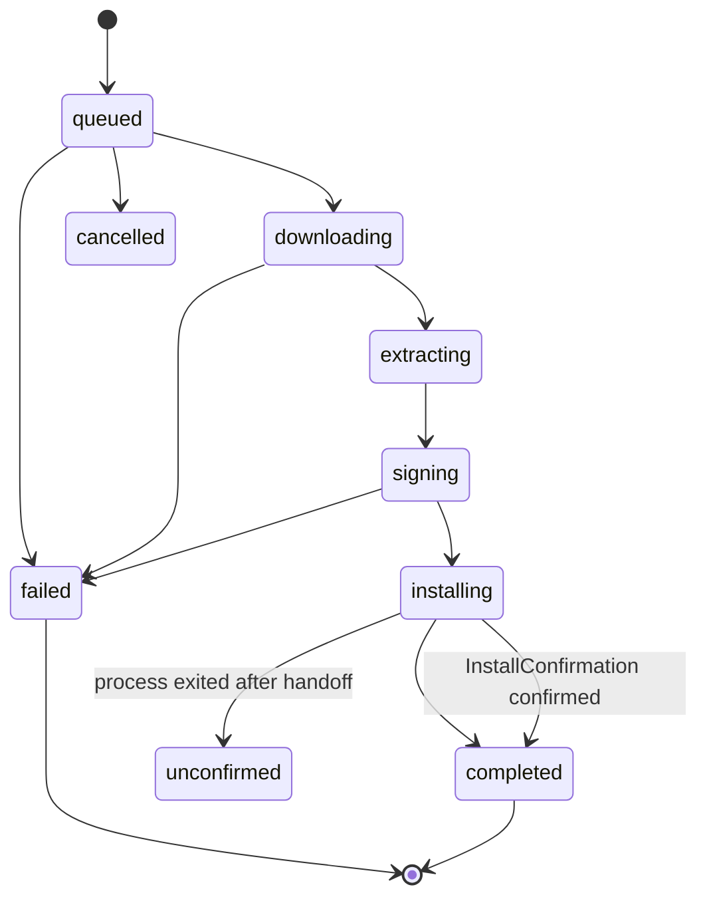
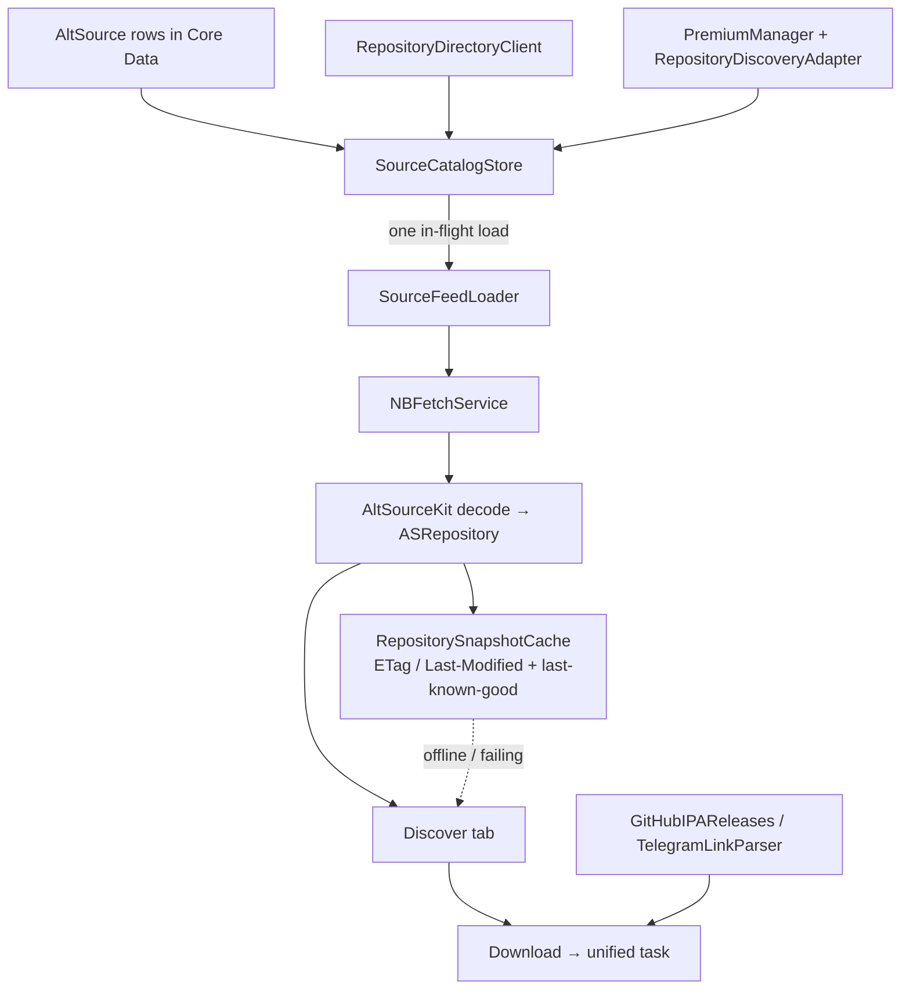

# How VexSign Works

A walkthrough of the codebase for someone who has never read it: what the app is made of,
why it is split that way, and what actually happens when a user imports, signs and installs
an app.

For the normative rules see [ARCHITECTURE.md](ARCHITECTURE.md) and
[dependency-rules.md](dependency-rules.md). For which upstream project each subsystem
learned from — and what may legally be copied from each — see
[REFERENCE_PROJECTS.md](REFERENCE_PROJECTS.md). This document is the explanatory narrative —
it trades some precision for readability and points at the authoritative file when the
distinction matters.

---

## 1. What the app does

VexSign is an on-device iOS toolbox for **re-signing and installing IPA packages without a Mac**:

| Capability | Where it lives |
| --- | --- |
| Import an IPA / TIPA, inspect its bundle, tweaks and entitlements | `Infrastructure/Archives` |
| Re-sign with a `.p12` + provisioning profile, or a cloud signer, or (experimental) an Apple ID | `Infrastructure/Signing`, `Engines/Cloud`, `Packages/NativeSigning` |
| Verify the output signature before declaring success | `Infrastructure/Signing/Verification` |
| Install over the air via a loopback HTTPS server + `itms-services` manifest | `Infrastructure/Devices/Installation/OTA` |
| Discover apps from AltStore-style repositories | `Packages/AltSourceKit` + `Infrastructure/Repositories` |
| Library management, backups, files, exports, widgets, Live Activities | `Presentation/Features/*`, `App/WidgetExtension` |

Everything is local: there is no required server for signing, and no account required for
the core path.

---

## 2. The 30-second mental model

Three ideas explain almost every design decision in the repo.

1. **One composition root.** `AppContainer.live()` builds every object graph exactly once.
   No type reaches for a singleton to obtain a *dependency*; singletons are only used for
   system-level facilities (logging, task center, download manager) that outlive scenes.
2. **Ports are protocols in `Domain`, adapters are in `Infrastructure`.** Use cases talk to
   protocols. Swapping zsign for a cloud signer, or Core Data for something else, does not
   touch business rules. A CI test enforces that `Domain` and `Application` import nothing
   but Foundation.
3. **One task model for everything long-running.** Downloads, imports, signing, installs and
   updates all publish into `UnifiedTaskCenter`, so the Tasks tab, the pill, widgets and the
   Dynamic Island read the same state instead of each inventing one.

---

## 3. Layered architecture



### The dependency rule

```mermaid
flowchart LR
    App --> Presentation --> Application --> Domain
    Infrastructure --> Domain
    Platform --> Domain
    Infrastructure -.x Presentation
    Application -.x Infrastructure
```

- **Inward only.** `Domain` knows nothing. `Application` knows `Domain`. `Presentation`
  knows `Application` + `Domain`. `Infrastructure` and `Platform` implement `Domain`
  protocols and never import `Presentation`.
- The arrows that are crossed out are compile-time forbidden and checked by
  `VexSign/Tools/Validation/repository-validation/test_repository_layout.py` and
  `test_architecture_boundaries.py`, which run under `make verify`.
- `App/Composition` is the **only** place allowed to import both sides. That is the
  composition root's job: it is the seam where the abstract arrows meet concrete types.

### Why feature-first, not layer-first

An earlier tree grouped `Views/`, `ViewModels/`, `Models/` at the top level, which meant a
change to the Signing screen touched four distant directories. The feature layout puts a
screen's view, view model, and view-only models side by side under
`Presentation/Features/<Feature>/`, while shared *business* logic stays in `Application`.
`test_feature_workspace_boundaries.py` keeps features from reaching into each other's
internals. The rationale is recorded in
[ADR-0001](../Decisions/ADR-0001-feature-layered-source-tree.md).

---

## 4. Composition root: how the app boots



`AppContainer` (in `App/Composition/AppContainer.swift`) is a `@MainActor final class`
whose initializer takes **every** dependency as a protocol-typed parameter. `live()` is the
production wiring; tests construct the same type with fakes. The container exposes:

- **workspace models** (`workspace`, `library`, `sources`, `certificates`, `signing`,
  `installationQueue`, `installation`, `signingPreferences`, `discovery`, `tweaks`,
  `entitlements`, `files`, `fileBrowser`, `archives`, `backups`, `tasks`, `appleAccount`,
  `repositories`, `repositoryBuilder`, `companion`, `analytics`, `cloudConfiguration`)
- **use-case factories** for flows that must be built per-invocation rather than held:
  `makeBatchWorkflow`, `makeDirectInstallUseCase`, `makeFirmwareDownloadUseCase`,
  `makeWorkspaceResetUseCase`, `makeDeepLinkRouter`, `makeHomeActionCoordinator`.

Factories exist because those use cases hold per-run state (a queue, a server, a lease);
a shared instance would leak state between invocations.

Deep links arrive through `_handleURL` → `container.makeDeepLinkRouter().handle(url)`,
which routes to tabs via `TabSelectionObserver` and to a specific app via
`AppNavigationManager.navigateToApp(...)` (debounced, 6 s expiry).

---

## 5. Domain model

`Domain` holds pure data and rules, with no UIKit, no Core Data, no file system:

- **Entities / ValueObjects** — app identity (`bundleIdentifier`, `version`, `teamID`),
  signing requests and plans, certificates, install requests, evidence records.
- **Enums** — `SigningStage`, `SigningCapability`, `UnifiedTaskPhase`,
  `InstallConfirmation.Phase`, `InstallationMethod`. Raw values of persisted enums
  (`SigningStage`) are **frozen**; changing one breaks stored history.
- **Protocols (27)** — the ports: `SigningEngine`, `SigningWork`, repository providers,
  workspace providers, `PlatformSystemAdapting`, `SecurityPolicyValidating`, task
  workspace, download/transfer ports.
- **Policies** — pure functions answering questions like "may this identity sign this
  bundle?", "what install method applies?", "is this artifact stale?". Policies are the
  only place business rules are allowed to live, which is why they are trivially testable
  and identical across UI, queue and automation paths.

### Persistence shape

Core Data holds *metadata*; the sandbox holds *bytes*.



`Storage.swift` is the single write path for imported/signed records, split into
`Storage+Imported`, `Storage+Signed`, `Storage+Sources`, `Storage+Certificate` and guarded
by `StorageConcurrency`. Secrets (certificate `.p12` contents, Apple ID credentials) never
enter Core Data: they live in the Keychain or protected files
(`Security/Secrets/SecureSecretStore.swift`).

Repository browsing is cached separately in `RepositorySnapshotCache` with ETag /
Last-Modified revalidation; `SourceCatalogStore` serializes all refreshes through one
in-flight task, coalesces duplicate requests by a generation token, and falls back to the
snapshot with `staleSourceIDs` marked so the UI can show stale-but-usable data offline.

---

## 6. The signing pipeline (the core of the app)

### 6.1 Flow



### 6.2 The decisions behind it

**Synchronous engine seam, async work seam.** `SigningEngine` is
`func sign(_ request: SigningEngineRequest) -> SigningEngineOutcome` — zsign is a C++
library and blocking on purpose. `SigningWork<Request, Artifact>` is the async port the
use case drives (`run(_:reporting:) -> Result<Artifact, Error>`). Pipeline stages stay
sequential and cancellable because each stage is a checkpoint:

```swift
try Task.checkCancellation()   // between copy / modify / verify
```

**Only one component may declare success.** `RunSigningUseCase` is the sole emitter of
terminal task events, and `.signatureVerified` is emitted **only** after
`SignatureVerifier` accepts. A file existing on disk, a zsign exit code, or 100 % progress
are all explicitly *not* evidence.

**Admission control in `SigningService`.** Before any work starts, `SigningService`:
1. dedupes by request id (`_runs`),
2. takes a per-bundle-id ownership lease from `AppOperationRegistry` so two flows cannot
   sign the same app concurrently (`_appOwners`),
3. asks `SigningCapabilityResolver` whether the current device/identity can run it,
4. runs the worker in `Task.detached`, relaying events back through an `AsyncStream` to
   the main actor,
5. releases the lease *before* notifying terminal observers, so a `.signed` handler can
   immediately enqueue an install.

**The plan is computed once, then reused.** `SigningPlan.make()` walks the bundle tree
(bounded: 50 000 entries, depth 32) and produces `Component { path, kind, identifier,
hasExecutable, isResourceOnly }`. It rejects symlinks, case-only collisions, `.xpc`/
`.xctest` inside the app, and loose Mach-O files. The same plan feeds review UI,
preflight checks and post-sign verification — so what the user is shown is exactly what
was validated.

**Preflight is advisory vs blocking.** `PreflightChecks` + `SigningCapabilityResolver`
turn plan facts into `SigningCapability.Issue`s marked blocking or advisory. Expired
certificate or missing entitlement → blocking. Missing icon or unusual bundle layout →
advisory, surfaced in Locales through `Platform/Apple/Localization/SigningCapabilityLocalization.swift`.

**Execution is serialized.** `SigningExecutionGate` ensures one execution at a time even
though planning can happen in parallel — signing is memory-hungry (whole IPAs are
unpacked and re-packed) and the device will be jetsammed otherwise.

**Unattended signing is explicitly granted.** `UnattendedSigningGrant` gates auto-sign
after import. It is a capability with a lifetime, not a hidden default.

### 6.3 Engines



All three are adapters for the same `SigningEngine` port, so the pipeline around them is
identical. `SigningErrorMapper` (619 LOC) is the single place zsign/cloud/noise is turned
into a typed, localizable, non-alarming error — deliberately large because a bad message
in a signing tool reads as "your build is broken".

---

## 7. Import → library workflow

```mermaid
flowchart TD
    A[User picks IPA / download finishes] --> B[AppFileHandler.copy]
    B --> C[extract + validate archive]
    C --> CF{ArchiveSafetyValidator<br/>traversal, size, symlinks}
    CF -->|reject| X[fail task, keep source]
    CF -->|ok| D[move to Imported/&lt;uuid&gt;]
    D --> E[MachO + Info.plist inspection]
    E --> F[addToDatabase → Storage]
    F --> G[extract icon]
    G --> H[UnifiedTaskCenter.recordImportedArtifact]
    H --> I[Library shows "ready to sign"]
    H -.->|UnattendedSigningGrant| J[auto-enqueue signing]
```

Key properties: the copy happens on a detached task but the security-scoped access is
acquired **synchronously** before handing off (`PackageImportService`), because the
picker's access window can close before the worker starts. Cleanup is best-effort
(`try?`) and a cleanup failure never fails an import that already committed.

Downloads are a separate subsystem (`DownloadManager`, singleton, `URLSession` background
session, own recovery journal) that mirrors into the task centre rather than being
reimplemented there:



---

## 8. Installation: the interesting part

Installing on iOS without a Mac or a paid developer account means impersonating the
`itms-services` flow. VexSign does it by serving the manifest and IPA from **inside the
device**:

```mermaid
sequenceDiagram
    participant Q as InstallQueue
    participant AI as AppInstaller
    participant SI as ServerInstaller (Vapor)
    participant TLS as LocalTLSIdentity / LocalCAProfile
    participant ID as installd
    participant CF as InstallConfirmation

    Q->>AI: install(app)
    AI->>SI: start() on random port 4000…8000
    SI->>TLS: serve HTTPS with local CA identity
    AI->>ID: open itms-services://?action=download-manifest&url=https://host/plist
    ID->>SI: GET /plist (manifest, bundle id, icon URLs)
    SI-->>ID: manifest + PNG icons
    ID->>SI: GET /ipa (payload, ranged)
    SI-->>ID: bytes
    Note over SI: bg task keeps server alive;<br/>status → sendingManifest → sendingPackage
    ID->>CF: lifecycle events / probes
    CF-->>Q: .installed / .unconfirmed / .failed
```

**Rules encoded here:**

- **A submitted install is not an installed app.** The only authority is
  `InstallConfirmation.Phase` merged with transport state by
  `InstallStatusPresentation`. Transport state alone can say "download finished"; it can
  never say "installed".
- **Generation tokens.** `InstallQueue` stamps every scheduled advance with
  `runGeneration`, and every attempt carries an `attemptID`. A completion arriving from an
  abandoned installer cannot advance, dismiss or rewrite a newer run.
- **One lookahead.** `_prepareNext()` pre-packages only the next entry, and only when the
  current transfer is a `localhost` OTA — preparation must overlap a transfer, not another
  archive build or another server.
- **Install method is a decision, not a flag.** `SigningModeManager.pipeline(for:)
  .installationMethodValue` maps to local OTA / semi-local / direct / export. An
  unresolvable route stays `-1` so the real installer reports an actionable error instead
  of the queue silently treating it as OTA.
- **Handoff may outlive the process.** On relaunch, a task handed off to installd becomes
  `.unconfirmed`, never `.completed` and never `.failed`
  (`UnifiedTask.recoverAfterRestart`). Neither can be inferred.
- Alternative paths in `Devices/`: `TrollStoreHandoff`, `DirectInstaller`,
  `LockdownClient`/`PairingBridge` (paired-device install), `CompanionClient` (companion
  device), `OTAExporter` (just produce the file).

---

## 9. Task centre: one state machine



`UnifiedTask.move(to:)` is the single transition authority — UI, persistence and receipts
all go through it. `UnifiedTaskPhase.canTransition(to:kind:)` makes illegal edges
impossible; `.queued → .installing` simply does not move. Progress is monotonic **within**
a stage (`TaskProgressRule.next`) but may legitimately reset **across** stages, and a
completed task is 100 % regardless of the last callback.

Reference semantics matter: `UnifiedTask` is a `final class` so in-place progress updates
publish through the `@MainActor` centre without diffing arrays. Background workers never
hold a task reference — they hold its **ID** and re-resolve it on the main actor. That is
why `PackageImportService` captures `importTaskID`, and why
`UnifiedTaskCenter.transition` takes the object but is always called from the main actor.

`TaskHistoryJournal` persists completed tasks; `TaskContext` records provenance
(`handoffAt`, `confirmationReason`, `monitoringActive`) so a restored record never
fabricates submission proof.

---

## 10. Repositories and discovery



`AltSourceKit` is a Swift package so the parsing model is testable without the app, and
`SourceCatalogStore` is the coalescing layer so pulling to refresh ten times does not open
ten network requests. `SourceURLPolicy` + `SecurityPolicyGateway` validate every URL
before the fetcher sees it — a repository feed is untrusted input that leads to code
installation, so it goes through the same policy gate as release manifests.

---

## 11. Security posture (design-level)

| Concern | Mechanism |
| --- | --- |
| Untrusted archives | `ArchiveSafetyValidator` (traversal, symlink, bomb, entry-count limits) |
| Untrusted URLs | `SourceURLPolicy`, `PackageDownloadURLPolicy` |
| Integrity of downloads | `DownloadIntegrity`, `FileIntegrity`, `ReleaseManifestVerifier` |
| Certificate secrets | Keychain / protected files; `ProtectedCertificateFiles`; never in Core Data |
| Certificate validity | `Identity/Certificates`, `OCSP`, `SigningIdentityPolicy` |
| Post-sign truth | `SignatureVerifier` + `Seals`, `NestedBundleAudit`, `ProfileCompatibility`, `ExecutablePreflight`, `BundleExecutableAudit` |
| Local server exposure | `TransferSecuritySession`, `LocalNetworkHost`, loopback-only default |
| Credential leakage | `CredentialMigrationDiagnostics`, redaction tests in `Tests/SecurityTests/CredentialRedaction` |
| App lock | `AppLockManager` + `Secrets/` |

Security tests are a separate target (`Tests/SecurityTests`, 14 files) so a UI-only test run
can never be mistaken for a security-green run.

---

## 12. Packages and companions

| Path | Role |
| --- | --- |
| `Packages/NimbleKit` | Shared utilities, JSON, view helpers used everywhere |
| `Packages/AltSourceKit` | AltStore repository/feed model + parser |
| `Packages/NativeSigning` | Experimental Apple-ID / CMS signing (crypto, anisette, provisioning) — not on a shipping path |
| `Packages/SideSign` | Signing support library |
| `Packages/Vendor/Zsign` | Pristine C++ zsign, bridged by `ZsignSwift` (see its `README.md` for the vendoring rules) |
| `Packages/Vendor/IDeviceKitten` | Low-level device services |
| `App/WidgetExtension`, `App/Watch`, `App/TV`, `App/Vision` | Companions reading shared snapshots, never reaching into app internals |
| `Services/WebManager` | Optional Python backend (repo hosting, relay) |
| `Services/Cloud` | Optional cloud signing service + shared contract tests |

Companions consume `WidgetStatusPayload` / `WatchSnapshotStore` — a push-style snapshot
boundary. That is why the watch app can show "signing 42 %" without any of the signing
code being linked into it.

---

## 13. Build, test, and the ratchets

```bash
make bootstrap     # resolve packages, generate projects
make build         # build all 5 schemes
make verify        # docs links + architecture boundary + layout + security policy tests
make test          # simulator unit + workflow tests
make lint [FIX=1]  # SwiftLint
make strict-concurrency
make audit-packages
```

`make verify` is the interesting one. It is not a style check — it is a set of **ratchets**
that fail the build when the architecture drifts:

- `test_repository_layout.py` — file locations and "Foundation-only" purity for
  `Domain`/`Application`.
- `test_architecture_boundaries.py` — forbidden cross-layer imports.
- `test_feature_workspace_boundaries.py` — features cannot import other features' internals.
- `test_public_blur_policy.py`, `test_private_launch_policy.py`,
  `test_private_defaults_policy.py` — policy defaults that must not silently weaken.
- `check-docs.py` — every local Markdown link resolves (this document included).

Test tiers:

| Tier | Location | Purpose |
| --- | --- | --- |
| Unit | `Tests/UnitTests/{Application,Archives,Devices,Identity,Persistence,Repositories,Signing}` | Pure logic, fakes for ports |
| Workflow | `Tests/WorkflowTests/{SigningWorkflow,InstallationWorkflow,RecoveryWorkflow}` | Multi-step state machines end to end |
| Security | `Tests/SecurityTests/*` | Adversarial inputs, redaction |
| Performance | `Tests/PerformanceTests` | Fixture-driven budgets |
| Package/contract | `Packages/*/Tests`, `Tools/Development/test_*contract.py` | Swift package + cross-repo contracts |

CI (`.github/workflows/ci.yml`) runs `quick` (verify/format), `build`, `tests` and
`concurrency` as separate jobs so a concurrency regression is attributable on its own.

---

## 14. Reading order for a newcomer

1. `App/iOS/App/Composition/AppContainer.swift` — see every concrete type named once.
2. `Domain/Protocols/Signing/*` — the seams that matter most.
3. `Infrastructure/Signing/Execution/SigningPipeline.swift` — the pipeline in ~200 lines.
4. `Infrastructure/Signing/SigningService.swift` — admission, leases, cancellation.
5. `Infrastructure/Tasks/UnifiedTaskModels.swift` — the state machine.
6. `Infrastructure/Devices/Installation/OTA/ServerInstaller.swift` — the OTA trick.
7. `Documentation/Architecture/ARCHITECTURE.md` and
   `Documentation/Architecture/dependency-rules.md` — the rules you must not break.

---

## 15. Where the design is deliberately conservative

- **No success without evidence.** Signed ≠ verified; submitted ≠ installed; 100 % ≠ done.
- **No state invention after restart.** Interrupted work becomes `.interrupted` or
  `.unconfirmed`, never assumed finished or assumed failed.
- **No hidden defaults.** Unattended signing needs a grant; loopback-only serving is the
  default; security policy downgrades are explicit and tested.
- **No silent retries.** Retry handlers are registered by live flows only; history
  restored from disk cannot retry something whose closure no longer exists.

These four rules cost code (the task centre alone is ~2 500 LOC across
`Infrastructure/Tasks`) and are the reason the app stays debuggable when an install fails
twenty minutes after the user walked away.
