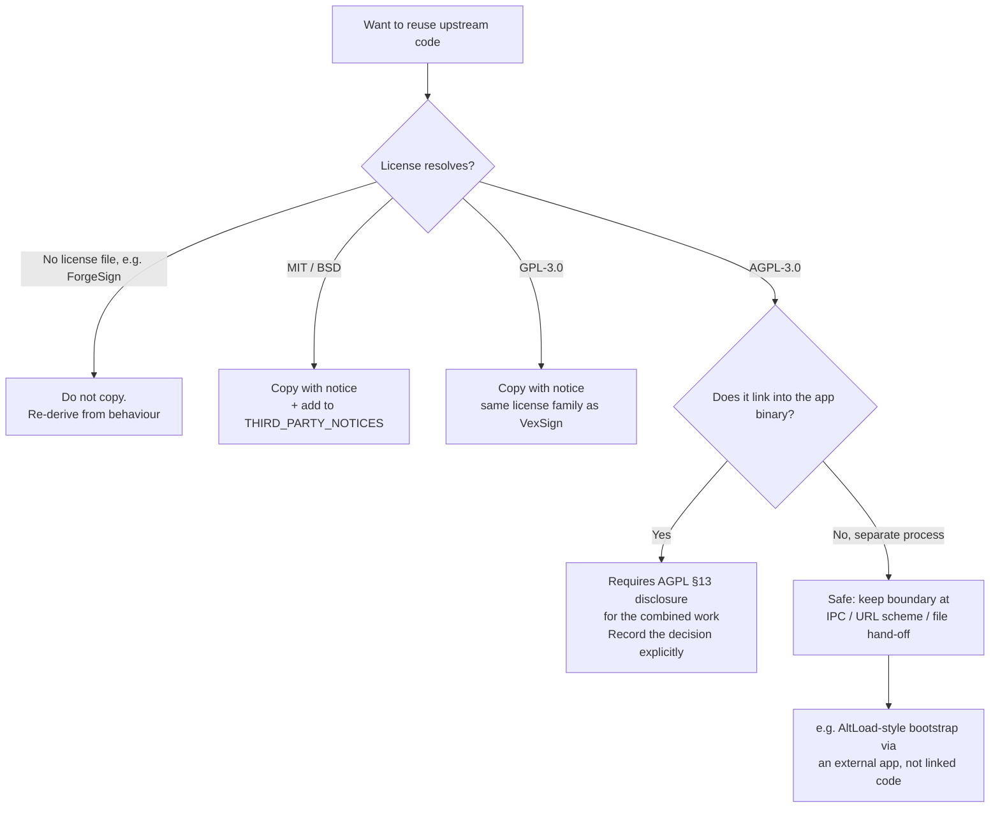

# Reference projects: what to take, and what may be taken

VexSign is assembled from ideas that already exist in a dozen on-device signing tools. This
document records **which upstream each subsystem's approach came from, what license that
upstream carries, and therefore what may legally be copied versus what must be re-derived**.

It is an engineering register, not legal advice. Read
[`THIRD_PARTY_NOTICES.md`](../../../THIRD_PARTY_NOTICES.md) before shipping anything that
contains upstream code, and preserve the notices of every component you actually copy.

---

## 1. Why this file exists

The brief for VexSign was "one coherent application with independent modules, not several
partially integrated signing applications." That goal is mostly a *licensing and
architecture* problem, not a feature problem:

- Copy-pasting a screen from a GPL fork into VexSign is fine only because VexSign is
  itself GPL-3.0 — but it still drags a maintenance obligation and often a Core Data schema
  with it.
- Copying **AGPL** code from SideStore or LiveContainer into VexSign is *also* compatible
  (GPL-3.0 §13 permits combining with AGPL-3.0 code), but the combined binary then has to
  satisfy AGPL's §13 network clause. VexSign already links AGPL `SideSign` and AGPL
  `EmbeddedContainer` sources, so this is a decision that must be made explicitly per
  component, not discovered later.
- The ideas — a loopback OTA server, a lease-guarded signing queue, a 7-day renewal
  schedule — are not copyrightable. Re-deriving them against VexSign's domain model is
  both cleaner and safer than transplanting code.

Verify status was checked with the GitHub API on **2026-11-22**. Licenses change; re-check
before porting.

---

## 2. Verified identities and licenses

| Project | Repository that resolves | License | Relevance |
| --- | --- | --- | --- |
| Feather | [`claration/feather`](https://github.com/claration/feather) | GPL-3.0 | Signing, certificates, repositories. The de-facto reference. |
| FeatherPlus | [`TomerGamerTV/FeatherPlus`](https://github.com/TomerGamerTV/FeatherPlus) | GPL-3.0 | Backup/restore + app management on top of Feather. |
| KSign | [`Nyasami/Ksign`](https://github.com/Nyasami/Ksign) | GPL-3.0 | Certificate-based signing, minimal surface. |
| KorSign | [`korboybeats/KorSign`](https://github.com/korboybeats/KorSign) | GPL-3.0 | Personal Feather fork; useful only as a diff. |
| RyukSign | [`faroukbmiled/RyukSign`](https://github.com/faroukbmiled/RyukSign) | GPL-3.0 | Feather + repository management + updates. |
| MySignReincarnated | [`gliddd4/MySignReincarnated`](https://github.com/gliddd4/MySignReincarnated) | GPL-3.0 | RyukSign with MySign features; WIP. |
| Odysseus | [`mirazbakis/Odysseus`](https://github.com/mirazbakis/Odysseus) | GPL-3.0 | Feather/FreeSign fork with free Apple Account support. |
| BatSign | [`8yy/BatSign`](https://github.com/8yy/BatSign) | GPL-3.0 | Automated signing, updates, background workflow. |
| NexStore | [`NexSideloading/NexStore`](https://github.com/NexSideloading/NexStore) | GPL-3.0 | AltStore repos, IPA patching, Zsign, install. |
| ForgeSign-iOS | [`Mesutcydev/ForgeSign-iOS`](https://github.com/Mesutcydev/ForgeSign-iOS) | **No license file** | Zsign + signing metadata + loopback OTA. See §3. |
| SideStore | [`SideStore/SideStore`](https://github.com/SideStore/SideStore) | **AGPL-3.0** | Apple Account auth, refresh, pairing, device comms. |
| LiveContainer | [`LiveContainer/LiveContainer`](https://github.com/LiveContainer/LiveContainer) | **AGPL-3.0** | Guest containers, multi-app, JIT. |
| AltStore | [`altstoreio/AltStore`](https://github.com/altstoreio/AltStore) | **AGPL-3.0** | Free account signing, provisioning, refresh. |
| AltLoad | [`mirazbakis/AltLoad`](https://github.com/mirazbakis/AltLoad) | `NOASSERTION` | Computer-free bootstrap/pairing. Treat as unlicensed until read. |
| Impactor | [`claration/Impactor`](https://github.com/claration/Impactor) | MIT | Pairing, local install, sideloading. **Only permissive core here.** |

Corrections to the brief's link list:

- `github.com/khcrysalis/feather` returns **404**; the resolving repository is
  `claration/feather`. The project has evidently changed hands or organization — check
  before citing either URL.
- **FlareStore** and **Zeus** have no public source (FlareStore publishes API docs only).
  Nothing can be ported from either; the certificate-status *idea* is already implemented
  locally in `CertificateStatusAssessment` and does not require their API.
- `korboybeats/KorSign` and `gliddd4/MySignReincarnated` are personal forks (2 and 1 stars)
  of Feather/RyukSign. Their value is as *diffs* showing one person's workflow, not as
  libraries.

### Already inside VexSign

| Component | Upstream | License |
| --- | --- | --- |
| `Packages/Vendor/Zsign` | zsign (C++) | MIT + Apache-2.0 component notice |
| `Packages/Vendor/IDeviceKitten` | `claration/IDeviceKit` @ `837cf1e` | MIT |
| `Packages/SideSign` | SideStore lineage | AGPL-3.0 |
| `Integrations/` (EmbeddedContainer) | LiveContainer lineage | AGPL-3.0 |
| `Packages/AltSourceKit` | — | MIT |
| `Packages/NimbleKit` | Nimble (Dynastic) lineage | MIT |
| `Resources/ellekit.deb` | ElleKit | BSD-3-Clause |

So the AGPL decision has **already** been taken for the guest-container and Apple-account
subsystems. The relevant question for any new module is narrower: does it add *new* AGPL
surface, and is that recorded?

---

## 3. The license decision tree

Rules this repository follows:

1. **Never port an unreasoned screen.** A view copied from a GPL fork brings its Core Data
   schema, its singletons and its bugs. Re-implement against `Domain` + a use case.
2. **Behaviour is free; code is not.** "Renew before the 7-day profile lapses" is an idea.
   `RenewalPlanner` is new code, written for VexSign's types, with VexSign's rules about
   what may be claimed.
3. **Cross-process integration beats linking** when the upstream is AGPL and the feature is
   peripheral (bootstrap, guest runtime). `EmbeddedContainerRuntime` already talks to the
   guest through a hand-off rather than linking its UI.
4. **No license file means no copying** — ForgeSign's loopback OTA is studied, then
   implemented independently (`ServerInstaller`), not vendored.

---

## 4. Capability coverage: upstream idea → VexSign module

The brief's source-to-module mapping, reconciled against what actually exists here.

| Subsystem | Upstream references | Where it lives in VexSign | State |
| --- | --- | --- | --- |
| Signing engine | Feather, KSign, ForgeSign, zsign | `Infrastructure/Signing/Engines`, `Vendor/Zsign` | Complete |
| Certificate management | Feather, Odysseus, NexStore | `Infrastructure/Identity/{Certificates,OCSP}`, `Features/Certificates` | Complete |
| Apple Account provisioning | SideStore, AltStore, Odysseus | `Packages/NativeSigning`, `Infrastructure/Accounts` | Experimental, `notIntegrated` |
| Initial installation | AltLoad, Impactor, SideStore | `Devices/Installation/OTA`, `TrollStoreHandoff`, `DirectInstaller` | Complete |
| Device pairing | SideStore, Impactor, AltLoad | `Devices/Transport/{PairingBridge,LockdownClient}`, `Vendor/IDeviceKitten` | Complete |
| IPA management | Feather, RyukSign, NexStore | `Infrastructure/Archives` (`IPAExplorer`, `MachOInspector`) | Complete |
| Repository management | Feather, RyukSign, Zeus, NexStore | `Packages/AltSourceKit`, `Infrastructure/Repositories` | Complete |
| Batch signing | BatSign, KSign | `Application/Signing/BatchSigningUseCase`, `Tasks/BatchJobRunner` | Complete |
| Background workflows | BatSign, SideStore | `Tasks/BackgroundAutomation` | Complete (opt-in, notify or sign+queue) |
| Guest containers | LiveContainer | `Platform/Compatibility/EmbeddedContainerRuntime`, `Integrations/` | Complete (AGPL) |
| OTA installation | ForgeSign, Feather | `Devices/Installation/OTA/ServerInstaller` | Complete |
| Certificate status | FlareStore API | `Domain/Services/CertificateStatusAssessment` (local, no third party) | Complete |
| Automated builds | BatSign, ForgeSign | `Tools/Release`, `.github/workflows/release.yml` | Complete |
| **Free-account renewal schedule** | **SideStore, Odysseus, BatSign** | **`Domain/Services/RenewalSchedule`, `Infrastructure/Identity/RenewalScheduleCoordinator`** | **Added — see §5** |

---

## 5. What the reference sweep actually changed

The audit found one capability that every free-account tool has and VexSign did not:
**a per-app renewal deadline**. VexSign could say whether a certificate was healthy
(`CertificateStatusAssessment`) and warn before it expired (`CertificateExpiryMonitor`), but
nothing answered "which signed app stops opening next, and can I fix it here?" — the entire
reason SideStore/AltStore exist.

Implemented without copying anything:

| File | Role |
| --- | --- |
| `Domain/Entities/SigningCredential.swift` | A credential as renewal sees it: kind, absolute dates, revocability, whether renewal is possible here. |
| `Domain/Services/RenewalSchedule.swift` | `RenewalStatus`, `RenewalPlan`, `RenewalPlanner` — pure, Foundation-only, clock injected. |
| `Domain/Entities/RenewalCredentialMapping.swift` | The one conversion from `CertificateRecord`/`WorkspaceSnapshot`. |
| `Infrastructure/Identity/RenewalScheduleCoordinator.swift` | `@MainActor` cache, one slot per source, published once per real change. Also `RenewalRenewabilityState`, the value-only session flag. |
| `Presentation/Features/Certificates/Views/RenewalSchedulePresentation.swift` | Row pill, header counts, and `Renewability`. |
| `Platform/Apple/Localization/RenewalScheduleLocalization.swift` | Wording, per the repo's localization convention. |
| `Tests/UnitTests/Identity/RenewalScheduleTests.swift` | 23 tests, boundaries asserted from both sides. |

### Where it is wired

| Surface | Behaviour |
| --- | --- |
| Certificate row (`CertificatesCellView`) | A pill for `due`, `urgent`, `lapsed`, `blocked` or `unknown`; suppressed for `notDue` so a healthy long-lived certificate gains nothing. |
| Certificate header (`CertificatesView`) | The `expiring` count is now `due`/`urgent`/`lapsed` from the planner, replacing an inline `expiration < 7 days` check that ignored the leaf certificate's earlier date. |
| Background pass (`BackgroundAutomation`) | `trackExpiringFreeAppleIDProfiles` feeds `NativeSigningManager`'s profiles into the `appleAccount` slot, clears that slot when signed out, and reports `renewalsDue` in the summary. |

**Two sources, one schedule.** Imported certificates and Apple Account profiles are
refreshed by different code at different times, so the coordinator keys plans by
`RenewalPlanSource`. A whole-array replace would have made each refresh erase the other's
deadlines — the test `testRefreshingOneSourceDoesNotEraseTheOther` pins that.

### Renewal is not the same question as in-process native signing

This distinction is the most important thing in this section, because getting it wrong
produced a UI that told every free-account user "Cannot renew here".

| Question | Answered by | State |
| --- | --- | --- |
| Does this build sign an in-process CMS signature against an Apple account? | `SigningMethodCapabilities.nativeAppleAccountSigning` | `.notIntegrated`, held by a device-evidence gate |
| Can fresh signing material be obtained for this credential on this device? | `Renewability` (`importedPair`, `freeAccount`) | `importedPair` is always true; `freeAccount` follows the signed-in session |

They are independent. An imported `.p12` + profile pair is renewed by provisioning and
re-importing fresh material — which the account hand-off already does end to end
(`NativeSigningManager.exportToCertificateStore` → `CertificateManagementService`, documented
in [NATIVE_SIGNING_HANDOFF.md](../Security/NATIVE_SIGNING_HANDOFF.md)). None of that requires
`nativeAppleAccountSigning` to be `.implemented`.

`Renewability.importedPair` is a literal `true` rather than a computation precisely so it
cannot drift back into the gated flag. `NativeRenewalSeamTests` fails if it does.

Rules encoded (each is a test):

- A 7-day profile becomes `due` inside a proportional window clamped to 1…7 days, and
  `urgent` in its final sixth — not at some arbitrary "3 days left".
- Revocation is `blocked`, never `due`: renewal cannot repair it.
- A credential with no renewal path (`canRenewOnDevice == false`, e.g. a cloud-held key) is
  `blocked` inside the window rather than reported as scheduled work.
- A row whose profile could not be parsed maps to `distantPast` → `lapsed`, not to a
  comforting invention.
- `nextAction` never returns `blocked`, so a background pass cannot spend a slot on work
  that will fail.

---

## 6. Remaining gaps worth closing next

Ordered by user-visible value, not by upstream popularity.

1. ~~Wire the schedule into UI and the background pass.~~ **Done** — see "Where it is wired".
   Remaining: `nextAction` is not yet acted on. Nothing in the app renews, because the
   renewal path it would call (`nativeAppleAccountSigning`) is still `.notIntegrated`.
2. ~~Make the limitation explicit.~~ **Done, and corrected.** The first version derived
   renewability from `SigningMethodCapabilities.nativeAppleAccountSigning`, which reports
   `.notIntegrated`, so every free-account certificate was labelled `Cannot renew here`.
   That was wrong: renewal does not depend on in-process CMS signing. Renewability now
   follows the signed-in session (`Renewability.freeAccount`), and the gated capability is
   left to `check-native-handoff.py` alone.

   **Promoting `nativeAppleAccountSigning` to `.implemented` is not a code edit.**
   `check-native-handoff.py` fails such a change unless
   `VexSign/Documentation/DeviceTesting/evidence/native-signing-promotion.json` records a
   genuine Apple-issued profile reaching the pinned production roots plus an eight-case
   physical-device ladder. Both are human observations on real hardware and a real account;
   they cannot be produced in this workspace and must not be fabricated. The hand-off seam
   itself is already built and reachable from `ProvisioningFlowView`.
3. **Credential kind is caller-supplied.** `CertificateRecord` has no origin field, so
   `SigningCredential(record:)` defaults to `.importedPair`. Adding an origin column would
   let the schedule size windows correctly for free-account identities instead of relying on
   the issue date.
3. **Refreshed-app correlation.** Per-app deadlines (per signed bundle, not per credential)
   are what BatSign offers; today one credential drive one plan. That needs a join from
   `Signed` rows to `certificateID`.
4. **NativeSigning is still `notIntegrated`** per the architecture docs. Odysseus is the
   closest reference for making that path real; it is GPL-3.0, so study and re-implement.
5. **Do not integrate a guest-container UI.** AGPL surface is already at its widest; the
   existing hand-off is the right boundary.

---

## 7. How to add a reference without breaking the architecture

1. Find the **rule**, not the screen. Write it in `Domain` as a pure type with the clock and
   dates injected.
2. Add the **port** in `Domain/Protocols` only if the rule needs I/O.
3. Implement the port in `Infrastructure`; keep `@MainActor` state in a single coordinator
   or adapter.
4. Put strings in `Platform/Apple/Localization/<Area>Localization.swift`.
5. Wire it in `App/Composition/AppContainer.swift` — nowhere else may know both sides.
6. Add the upstream to `THIRD_PARTY_NOTICES.md` **only if code was copied**. An idea is not
   a dependency.
7. Run `make verify`; the ratchets will fail a layer violation before review does.
