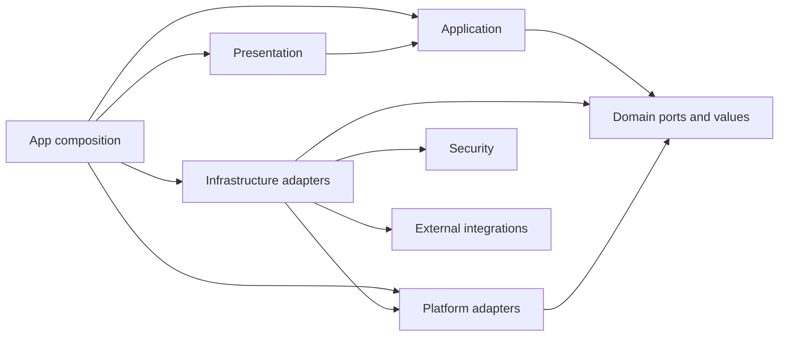
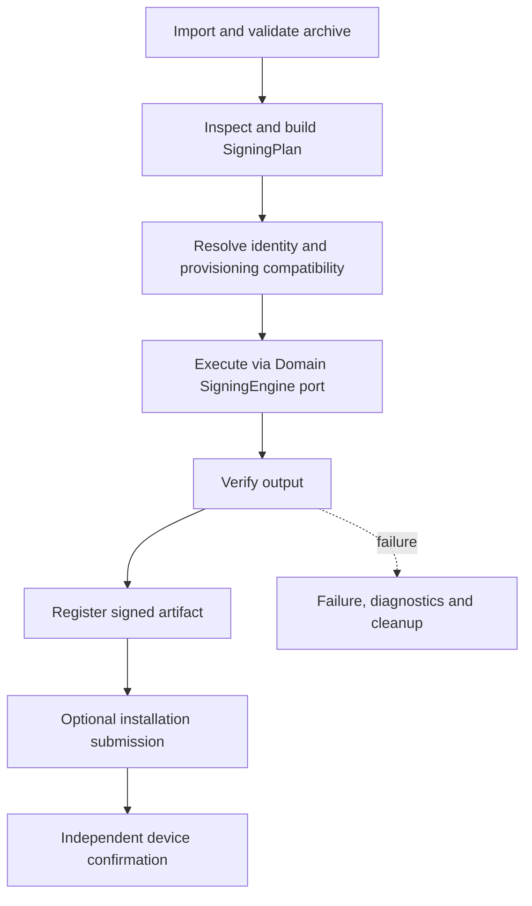

# VexSign dependency rules and diagrams

The physical source owners are **App, Presentation, Application, Domain,
Infrastructure, Platform, Security and Resources** under
`VexSign/App/iOS/VexSign/`. External integrations (existing packages/services/host)
and Tooling have separate repository owners. This is one existing app target,
not eight manufactured Swift modules. Existing package compilation boundaries
are retained.

The [architecture guide](ARCHITECTURE.md), [component map](component-map.json),
[migration record](feature-layout-migration.md) and
[ADR-0001](../Decisions/ADR-0001-feature-layered-source-tree.md) describe current
code. The [initial audit](../Decisions/Research/architecture-excellence-audit.md)
and [source-guided decisions](../Decisions/Research/source-guided-architecture-decisions.md)
are historical context, not acceptance of a later tree.

## Responsibility and dependency rules

| Owner | Allowed responsibility | Forbidden direction / shortcut |
| --- | --- | --- |
| App | Scenes, bootstrap, composition, lifecycle, navigation; select and inject concrete implementations. | Business logic in the scene entry point; another mutable global container. |
| Presentation | Features, view state, UI components, accessibility; forward intent to Application/Domain interfaces. | New direct signing, key/ZIP/device API, Core Data, raw network or filesystem workflows. Guarded coupling is zero and ratcheted; other UI/platform detail is not an exhaustive dependency proof. |
| Application | Coordinate workflow policy through injected Domain ports, with Foundation only. | UI/SDK imports, concrete singleton lookup, direct filesystem or HTTP implementation. |
| Domain | Framework-independent entities, value objects, enums, protocols, policies/services, results/errors. | UI/database/engine/Keychain/HTTP imports or implementation; `.shared`, `FileManager`, `URLSession`, bundle I/O. |
| Infrastructure | Implement Domain ports; existing signing/archive/account/device/repository/persistence/task implementations; may use Platform/Security/external adapters. | A second signing pipeline, task center, device coordinator or canonical app registry; owning UI state. |
| Platform | Wrap supported Apple/iOS APIs, security-scoped access, device/files/background/notifications and compatibility. | Leaking framework types into Domain contracts; claiming entitlements or device access the build does not possess. |
| Security | Credential protection, archive/network/storage validation and log privacy at real boundaries. | Secrets in normal metadata/configuration/logs, unbounded extraction or unchecked redirects. |
| Resources | Actual app assets/localizations/bundled reference data and licenses. | Business policy hidden in resources or credentials bundled with the normal build. |
| External integrations | Existing Swift packages, vendored code, optional Cloud/WebManager and experimental host. | Mandatory cloud for local workflows; automatic upload of Apple passwords/private keys. |
| Tooling | Scripts, repository/architecture/security validation, development fixtures and release tooling. | Treating text checks as native compilation or changing security baselines automatically in CI. |

Dependencies point **inward** toward Domain contracts. Composition knows the
concrete adapters; Application does not.



**Prohibited:** Domain → Infrastructure/Platform/Presentation/SDKs;
Application → concrete stores/engines/platform implementations. The
[reviewed ratchet](../../Tools/Validation/architecture-rules/architecture-drift-baseline.json)
now records zero guarded Presentation shortcuts and preserves the previous
review in history. Zero matches are not proof of every possible dependency edge.

## Existing single owners

| Concern | Authoritative implementation; not a replacement module |
| --- | --- |
| Signing admission and cancellation handles | `SigningService` + `AppOperationRegistry` |
| Signing terminal/progress contract | `RunSigningUseCase` through `SigningWork` |
| Signing execution | `SigningPipeline` → `SigningHandler` → `SigningEngine` (`ZsignAdapter`) |
| Verification and artifact registration | `SignatureVerifier`, existing handler/storage, `PostSignArtifacts` |
| Imported/signed-app registry | Core Data `Storage` and existing library services |
| Long-running task state and journal | `UnifiedTaskCenter`, `TaskHistoryJournal` |
| Installation queue and device verdict | `InstallQueue`, `AppInstaller`, `InstallConfirmation` |
| Capability/device transport | Existing resolver and `DeviceConnectivity` |
| Repository refresh and downloads | `RepositorySyncEngine`, `DownloadManager` |
| Identity and secure material | `IdentityVault`, `CertificateSecrets`, `SecureSecretStore` and account stores |
| Backup/restore | `BackupManager`, `BackupRestorePlan`, existing encrypted container |

The `coreSystems` array in [component-map.json](component-map.json) maps the
proposal's logical owner names to these actual implementations. It is not a list
of new duplicate classes.

## Controlled signing workflow



`.signatureVerified` means the actual verifier accepted output.
`.finished(artifact)` means a signing run registered an artifact, **not** that
an app was installed. Direct results name submission rather than installation.
`InstallConfirmation`/the existing native acknowledgement rules own the verdict.
A capability report or a ready OTA server cannot supply that evidence.

## Enforced checks

- `test_repository_layout.py`: the original-file mapping, populated feature/layer
  tree, immutable feed/binary resource bytes, root aliases, existing target
  groups/membership exceptions, rooted build/header/package paths, optional
  service build/runtime paths, and Foundation-only Domain/Application.
- `test_architecture_boundaries.py`: original strict Presentation files plus
  current ViewModels, refactored view boundaries and composition wiring.
- `test_architecture_excellence.py`: whole-Presentation no-new-coupling ratchet
  and component evidence. Expanded coverage was reviewed against original bytes;
  current zero debt retains that provenance and synthetic detection probes.
- `test_feature_workspace_boundaries.py`: consumed feature wiring, callback identity,
  cancellation/lease ordering, durable certificate recovery, reviewed signing
  completion, separate consent gates and allowlisted backup previews.
- `audit_feature_preservation.py`: optional read-only comparison with original Git
  blobs: complete inventory, binary/license/mode/URL preservation, path-only notice
  and licensing-index edits, protected inputs, exact target/product identities,
  declared configuration values after xcconfig extraction, package identities,
  target-relative membership and optional Swift grammar comparison. Requires the
  original revision locally; never changes a baseline or evaluates an Xcode build.
- `test_feature_preservation.py`: 22 offline positive/negative auditor fixtures,
  including changed license terms, pins, target/setting identities, lost shared
  membership, alias drift and a stale report attempting to hide a removed URL.
- Existing URL/archive/privacy/logging/error/singleton/concurrency/native-promotion
  gates remain in `make verify` and the CI quick job.
- Real XCTest sources exercise the injected ports, signing event contract,
  cancellation and failure cases; they still require macOS/Xcode execution.

```sh
python3 VexSign/Tools/Validation/architecture-rules/test_architecture_excellence.py --report
make verify
make test  # macOS/Xcode
```

`--write-baseline` exists for intentional reviewed migrations only. It is not a
CI repair step or permission to suppress new violations. A green portable pass
is not Build-verified or Device-verified evidence. Build/test the exact reviewed
revision on Xcode and follow the [device guide](../DeviceTesting/DEVICE_TESTING.md)
before making either claim.
